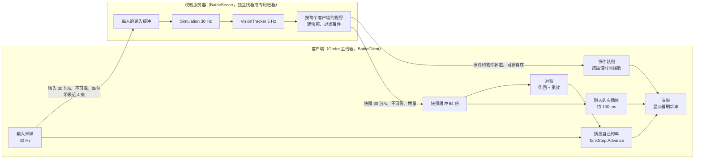
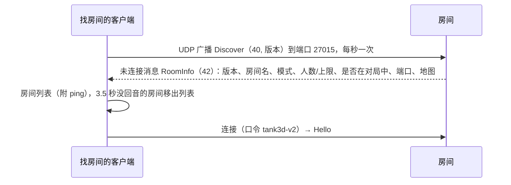

# 03 · 网络同步架构

目标：局域网上自己的车零延迟，别人的车平滑不抖，偶尔丢包看不出来；服务器说了算，没被点亮的敌人在客户端收到的字节里查不到位置。

代码在 `src/Tank.Net`：`Battle/`（协议、服务器、客户端、预测、插值）、`Timing/`（`ServerRunner`、`ClockSync`）、`Transport/`（LiteNetLib 封装、内存回环网络、局域网发现）、`Protocol/`（位流、通道）。设计依据见 [阶段 4 联网设计](superpowers/specs/2026-10-18-stage4-networking-design.md) §5。

## 1. 卡顿从哪里来

有线局域网往返延迟 < 1 ms，Wi-Fi 一般几毫秒，偶尔有几十毫秒的尖峰。局域网上的卡顿主要不是延迟造成的：

| 卡顿来源 | 现象 | 对策 |
|---|---|---|
| 等服务器确认才动 | 按键发粘 | 客户端预测（§6） |
| 收到包就直接摆位置 | 别人的车一跳一跳 | 插值 + 抖动缓冲（§7） |
| 仿真频率和屏幕刷新率不一致 | 高刷屏上微抖 | 固定步长 + 两 tick 之间插值（§3.2） |
| 位置走可靠通道 | 丢一个包，后面全被卡住 | 快照走不可靠通道，按已确认的基线做增量（§4.4） |
| 预测错了直接拉回 | 橡皮筋 | 小误差平滑掉（§6.2） |
| 开炮等服务器 | 开火延迟 | 自己的炮弹本地预测（§6.3） |
| Wi-Fi 丢包 | 偶发卡顿 | 输入冗余、自愈的增量快照、短时外推（§4.3、§7.2） |
| GC 停顿、服务器 tick 不准 | 周期性卡顿 | 热路径零分配，服务器独立线程高精度计时（§9.3） |

## 2. 总体架构



- **服务器是唯一的事实来源**：客户端只上传输入（油门、转向、瞄准角、开火、弹种），从不上传位置或命中。
- **两边跑同一份仿真代码**：服务器用 `Simulation.Step`，客户端预测自己的车用同一个 `TankStep.Advance`。
- **每个客户端一份快照**：服务器按这个人能看到什么给他单独建快照，单独做增量。

### 2.1 参数总表

| 参数 | 值 | 代码 |
|---|---|---|
| 仿真和快照频率 | 30 Hz（33.3 ms） | `SimConstants.TickRate` |
| 输入 | 每 tick 一包，带最近 4 条（冗余） | `BattleProtocol.MaxRedundantInputs` |
| 客户端领先服务器 | 往返时间 + 2 个 tick | `ClockSync.TargetSlackTicks` |
| 插值延迟 | 3～6 个 tick（100～200 ms），按抖动自动调整 | `BattleInterpolator` |
| 外推上限 | 3 个 tick（100 ms） | 同上 |
| 对账：平滑还是拉回 | 误差 < 0.5 m 平滑（约 150 ms 消掉），≥ 0.5 m 直接拉回 | `BattlePredictor.SnapDistance` |
| 增量基线历史 | 每个客户端 64 份快照 | `BattleSeat.HistorySize` |
| 点亮计算 | 每 6 个 tick（5 Hz），失去后保持 2 秒 | `VisionTracker` |
| 默认端口 | UDP 27015 | `BattleProtocol.DefaultPort` |
| 协议版本 / 连接口令 | 3 / `tank3d-v2`（口令没随版本改，旧版本照样连得上、会被告知版本不一致） | `BattleProtocol` |
| 地图物件上限 | 16384 个（事件批次里的物件状态仍是 4096） | `BattleMessages.MaxMapProps` |
| 不可靠包上限 | 1000 字节，超过的快照改走可靠通道（§4.1） | `BattleServer.MaxUnreliableBytes` |
| 一个房间 | 10 个座位（真人加机器人） | `BattleProtocol.MaxPlayers` |
| 断线保留座位 | 30 秒 | `BattleServerOptions.ReconnectGraceSeconds` |
| 下行预算 | 每个客户端 < 20 KB/s | `tests/Tank.Soak` |
| 延迟补偿 | 不做（§8） | |

## 3. 时间模型

### 3.1 服务器的一个 tick

`BattleServer.Tick` 按固定顺序：

1. 收包（输入进各人的输入缓冲，房间命令、Hello 当场处理），处理待踢的连接、超时的 Hello、过了保留期的断线座位；
2. 给每辆车取这个 tick 的输入：真人从输入缓冲取，机器人由 `SkirmishBot` 给；
3. `Simulation.Step`；
4. `VisionTracker.Update`（每 6 个 tick 真正算一次）；
5. `MatchRules.Update`：复活、保护期、计分、胜负；
6. 对每个在对局里的客户端：按视野过滤这一 tick 的事件、连同物件变化一起发；建快照、发；
7. 对局结束 8 秒后回房间；房间状态有变化就广播。

### 3.2 客户端的固定步长

`BattleClient.Update` 每帧调用一次（对局中由 `MatchMain` 独占调用）：

```text
ticks = ClockSync.Advance(dt)              // 这一帧该走几个 tick
for each tick: 采样输入 → 预测一步 → 发输入包 → 本地炮弹走一步
Interpolator.Advance → 播放到点的事件 → 插值采样别人的车 → 平滑偏移衰减
自己的车画在 lerp(上一 tick, 这一 tick, Clock.Alpha) + 平滑偏移
```

- 仿真固定 30 Hz，渲染跟着显示器走，自己的车在相邻两个 tick 之间插值，高刷屏上也不抖。
- 开火键“锁存”：两个 tick 之间按下又松开的点击不会丢（`Driving/Logic/FireLatch`），被一个 tick 用掉才清。

### 3.3 时钟同步（`Timing/ClockSync`）

客户端在 tick T 的输入要在服务器算 T **之前**到。所以客户端的预测时钟要领先服务器：

```text
开始时：clientTick = serverTick + ceil(往返时间 × 30 + 2)
```

- 每份快照带“输入余量”：服务器收到的最新输入比当前 tick 早多少 tick。客户端对它做指数平均，目标 2 个 tick；偏差超过 0.75 个 tick 时**微调时间流速**（最多 ±5%），不跳 tick。
- **硬重同步**（重新按上面的公式起步）有两种情况：
  - 输入余量偏离目标超过 20 个 tick；
  - **服务器的 tick 追上或超过了客户端自己的 tick**。客户端落后时（一帧太长，引擎截断的时间没补回来）它的输入到得太晚、全被丢掉，余量反馈也就没了，这是唯一的信号。
- 一帧最多补 8 个 tick，再多就直接跳过去（拖窗口、断点），不一口气重放一串输入。

## 4. 协议

### 4.1 通道

LiteNetLib 两种投递方式（`Protocol/Channel`）：

| 通道 | 投递方式 | 内容 |
|---|---|---|
| `Unreliable` | 不可靠 | 输入（C→S）、快照（S→C） |
| `Reliable` | 可靠有序 | Hello、Welcome、Reject、房间状态、房间命令、开局数据、事件批次、请求重发对局数据；超过 1000 字节的快照 |
| 未连接消息 | 广播 / 单播 | 局域网发现 |

不可靠包上限是 1000 字节（`BattleServer.MaxUnreliableBytes`）：LiteNetLib 2.1.4 关掉 MTU 探测时，单个不可靠包最多 1023 字节，再大就抛异常（`TooBigPacketException`），丢掉那一 tick 后面的处理。阶段 4 定的 1150 超过了这个上限，5A 改为 1000 并加了测试。

### 4.2 消息（`Battle/BattleProtocol.cs` 的 `BattleMessage`，每包第一个字节）

| 方向 | 消息 | 编号 | 内容 |
|---|---|---|---|
| C→S | `Hello` | 1 | 协议版本、名字（≤ 24 字节）、重连令牌 |
| C→S | `Input` | 2 | 见 §4.3 |
| C→S | `RoomCommand` | 3 | 选模式、设机器人数、开局、回房间（只有房主）；选地图（只有房主、不在对局中，`SetMap`）；选队、选车（不在对局里时）；准备 |
| C→S | `RequestMatchState` | 4 | 请求重发开局数据，一个标志位说要不要带地图（§9.5） |
| S→C | `Welcome` | 20 | 座位号、会话令牌 |
| S→C | `Reject` | 21 | 原因（版本不一致、房间已满） |
| S→C | `RoomState` | 22 | 模式、房主座位、机器人数、是否在对局中、每个座位（名字、队伍、车型、准备、在线、是否机器人）；房间的地图名（≤ 16 字节）和它的状态（生成中 / 就绪 / 失败） |
| S→C | `MatchStart` | 23 | 模式、对局编号、当前 tick、结束 tick、一个标志位和地图数据（带地面类型和水位，§4.6；同一局的重同步不带）、和初始状态不同的物件、你的车号。不带地图名，客户端按房间状态里的取 |
| S→C | `Snapshot` | 24 | 见 §4.4 |
| S→C | `Events` | 25 | 一个 tick 的事件和物件变化 |
| 广播 | `Discover` | 40 | 后面跟协议版本 |
| 回复 | `RoomInfo` | 42 | 版本、房间名、模式、人数 / 上限、是否在对局中、端口、地图名（版本 ≥ 3 才有） |

### 4.3 输入包（C→S）

```text
u8      type = Input
varuint newestTick          // 本包最新一条输入的 tick
varuint ackSnapshotTick     // 客户端收到的最新快照，服务器拿它当增量基线
u3      count (1..4)
count × { u2 throttle, u2 steer, u16 aimYaw, u16 aimPitch, u1 fire, u1 ammo }   // 从 newestTick 往前排，每条 38 位
```

- **瞄准量化**：偏航、俯仰各 16 位。客户端预测时也用量化后的值（`BattleProtocol.QuantizedAim`），两边算的是同一个数。
- 服务器的输入缓冲（`BattleInputBuffer`，128 个 tick 的环形队列）：重复的副本丢掉；已经算过的 tick 丢掉（记作迟到）；比当前 tick 超前 64 个以上的不收。某个 tick 没收到输入时，**重复上一条但不开火**，最多重复 6 个 tick，之后当作松手：车停下，炮保持原来的瞄准。
- 每个 tick 的输入都会先经过 `TankStep.Sanitize` 清洗（轴值夹紧、非法瞄准角换成当前炮塔朝向），坏包不会让炮塔乱转。

### 4.4 快照（S→C）

每个客户端单独一份，按这个客户端确认过的基线做增量（Quake 3 的做法）：

```text
u8      type = Snapshot
varuint tick, baselineTick                 // baselineTick = 0 表示完整快照
varint  lastProcessedInputTick, inputSlack // 给对账和时钟同步
对局块：阶段、剩余 tick、被点亮、胜方队伍、胜方座位、复活倒计时、两队得分
自己的车：有没有；和基线相同就一位，否则完整状态（32 位浮点）
计分块：和基线相同就一位，否则每个座位（队伍、车型、车号、击毁、阵亡、存活、名次）
实体：变化了的车逐个 { u1 = 1, varuint 车号差, u9 变化掩码, 变化的字段 }，最后 u1 = 0
删除：基线里有、这次没有的车逐个 { u1 = 1, varuint 车号差 }，最后 u1 = 0
```

- **自己的车**给对账用，精度要让回放和服务器对上：位置、偏航、炮塔、炮管、速度、装填、散布扩大量都是 32 位浮点；另有弹种、两种弹的数量、开炮次数（散布种子要用）、血量、保护期、最后开炮 tick、是否阵亡。
- **别的车**：车号、座位、车型、队伍；x、z（1 cm，对基线差分）；偏航和炮塔偏航各 12 位、炮管俯仰 10 位；速度（0.1 m/s，给履带动画）；血量；标志位（阵亡、保护期）。高度和车体倾斜由客户端从地形推算。
- **基线**：客户端每个输入包都带着自己收到的最新快照 tick。服务器每人存最近 64 份快照，确认的那份还在就拿它做基线，否则发完整快照。中间丢多少份都不影响下一份解码，不需要重传。
- 快照超过 1000 字节（LiteNetLib 一个不可靠包装不下，§4.1）时改走可靠通道。soak 结束时各客户端最近一份快照约 71～105 字节（§11）。

### 4.5 事件（S→C，可靠有序）

服务器每 tick 把仿真的事件按客户端过滤后打成一批发送（`Battle/Visibility.cs` 的 `Viewer.Wants`）：

| 事件 | 发给谁 |
|---|---|
| 开炮 `ShellFired`（起点、速度、弹种）、炮弹爆炸 `ShellExploded` | 所有人 |
| 命中 `TankHit`（击穿 / 跳弹 / 未击穿、伤害）、溅射 `SplashDamage`、击毁 `TankDestroyed` | 射手本人，以及看得见目标的人 |
| 复活 `TankRevived` | 看得见这辆车的人（自己的车总能看见） |
| 物件受伤 `PropDamaged`、被毁 `PropDestroyed` | 所有人 |

- **射手车号抹掉**：任何事件里的射手车号，只有射手是自己、或射手在这个客户端的视野里（本队看得见；各自为战里阵亡或还没车的人看全场）时才带，否则写 0。否则开炮、爆炸、物件、命中事件会把看不见的射手暴露出来。
- 同一批里附上这一 tick 被碰过的物件的新耐久（§4.6）。

### 4.6 物件状态与地图

- **物件状态**：物件 id → 耐久，8 位量化（0 只表示倒了，255 只表示完好）。客户端**一收到就应用**，预测马上按新地形开（缺口炸开了就能开过去）；物件的画面也按它更新。
- **地图**：开局时服务器把地图整个发过去（`MatchStart` 里的 `MapData`），走可靠通道。客户端不自己生成地图，因为不同 CPU 上 `MathF` 末位可能不同，生成结果会对不上（见 [02 §5](02-tech-stack.md#5-仿真30-hz浮点自己写物理)）。编码（`BattleMessages.WriteMap`，v3）：
  - v2 的部分逐字节不变：高度按 1 cm 取整、逐点差分；物件表（编号、种类、中心、半宽、朝向、下沿、高度），种类 0～6（岩石、草丛、砖墙、石墙、栅栏、房子、树），最多 16384 个；
  - 后面必有一段：1 字节标志（第 0 位：有水；其余位必须为 0）；有水时水位（厘米，有符号变长整数）；每 2 m 一格的地面类型按行程编码（段数，每段“长度 ≥ 1 + 种类”，长度合计等于格子数）。
  - 解码先查剩余字节够不够再分配（物件数、段数都一样），种类上限取自仿真（`Prop.LastKind`、`SurfaceMap.LastKind`），开局消息里的物件状态数不超过地图的物件数。
- **大小**：试驾场地图 53 KB（201 × 201 个采样点、351 个物件，测试要求 < 90 KB）；河谷的开局消息 555 245 字节（约 542 KiB：601 × 601 个采样点、5560 个物件，测试要求 < 1 MiB），编码、解码各十几毫秒（Release）。服务器每张图只编码一次（`ServerMaps`），每个座位的开局消息直接拷贝这段字节。
- 加入、重连、重同步时，`MatchStart` 带上所有和初始状态不同的物件。同一条连接在同一局里已经收到过地图时，重同步的 `MatchStart` 不带地图（只有十来个字节，再加上变了的物件状态，§9.5）。

### 4.7 带宽

预算：10 辆车时每个客户端下行 < 20 KB/s。实测（4 个客户端 + 4 个机器人）下行最大 3.5～4.2 KB/s，上行约 0.7 KB/s，见 §11。

省带宽靠这几点：只发看得见的车；位置差分、角度量化；没变的字段不发，没变的自己的车和计分块各一位；炮弹不逐 tick 同步，只发开炮事件，由客户端自己算弹道。

## 5. 可见性裁剪

只在服务器上判断（`Battle/Visibility.cs`）：

| 客户端的状态 | 快照里有哪些车 |
|---|---|
| 活着 | 自己；队友；本队看得见的敌人（`VisionTracker.IsVisible`，含 2 秒保持）；所有残骸 |
| 两队模式里阵亡 | 同上（看本队视野） |
| 各自为战里阵亡 | 全部 |

- 看不见的敌人不出现在快照的实体列表里，没有位置和姿态；但计分块照常列出所有座位（车号、队伍、车型、战绩、是否存活）。敌人从视野里消失时，快照里发一条“删除”。
- “被点亮”标志：有任何敌方队伍看得见自己时为真，放在快照的对局块里，HUD 的灯直接用它。
- 测试 `BattleIntegrationTests.An_enemy_out_of_sight_is_not_in_the_snapshots_or_the_events_and_a_shot_from_the_dark_has_no_shooter` 检查解码后的快照、插值结果和事件里都没有这辆车（计分块除外），黑暗里开的炮射手号为 0。

## 6. 客户端预测与对账（自己的车）

### 6.1 预测

- 每个 tick 用 `TankStep.Advance` 在客户端自己的地图上走一步：行驶、炮塔、炮管、散布、装填、开炮，和服务器一样。
- **不撞倒物件**：预测时，会被撞倒的物件（栅栏、树，重坦超过 15 km/h 撞上的砖墙，中坦、重坦超过 20 km/h 撞上的房子）照穿过去但不撞倒，撞穿砖墙和房子的减速照算；倒没倒只听服务器的物件事件。
- **地面和水**：两边的 `Battlefield` 带着同样的地面类型和水位（来自同一份 `MapData`），速度系数在 `TankStep.Advance` 里算，预测不会因为地面产生偏差。
- 别的车按最新快照里的位置当障碍物。它们来自略旧的快照，贴身顶车时会有一点误差，交给对账平滑。
- 输入历史保留 128 个 tick。

### 6.2 对账

1. 收到最新快照时，从服务器给的自己的车状态出发，重放服务器还没处理的输入（`lastProcessedInputTick` 之后的）。对局结束后不再重放。
2. 和原来预测的位置比：
   - 误差 < 0.5 m：放进画面偏移，按时间常数 50 ms 衰减，约 150 ms 消掉 95%；
   - 误差 ≥ 0.5 m：直接拉回；
   - 服务器确认的输入比保留的 128 个还旧时不重放，直接用服务器状态并拉回（防止伪造的确认让客户端重放几百万个 tick）。
3. 复活到别处不算修正，直接换位置。
4. 统计：修正次数（≥ 2 cm 才算，更小的是厘米量化和浮点噪声）、最近一次、平均、最大，给 F3 面板。

完美网络下修正为 0（测试 `On_a_perfect_link_the_prediction_is_never_corrected`）。

### 6.3 自己的炮弹

- 开炮时本地马上生成一发预测炮弹，散布种子和服务器相同，所以弹道一样。
- 服务器的开炮事件到了，按 **tick** 对上号（一辆车一个 tick 最多开一炮），换成服务器的炮弹 id。客户端落后时事件先到，记下来，预测到那个 tick 时直接算已确认。
- 没对上的（比如服务器那边其实没开出来），在插值时钟过了那个 tick 1.5 秒后删掉。
- 命中、伤害、击毁只看服务器的事件；预测炮弹打到地面或墙就先藏起来，等服务器的爆炸事件。

## 7. 别的车和炮弹

### 7.1 插值（`Battle/BattleInterpolator`）

- 别的车画在过去：渲染 tick = 估计的服务器 tick − 插值延迟。快照缓冲里找夹住它的两份，线性插值位置和角度；血量、标志位在中点切换。
- 插值延迟 = 1 tick + 到达抖动峰值 × 1.2 + 半个 tick，夹在 3～6 个 tick（100～200 ms）之间，每秒最多变 1 个 tick，画面不会突然变快变慢。抖动峰值逐份衰减，一次长卡顿几秒后就淡掉。
- 两份快照之间位置跳了 20 m 以上算复活，不插值。渲染时钟和应在的位置差超过 8 个 tick 时直接对齐。

### 7.2 外推

渲染 tick 超出最新快照时（连续丢包），按最近两份快照算出的速度往前推，最多 3 个 tick（100 ms），之后原地停住等新快照。外推帧数计入统计。

### 7.3 别人的炮弹与事件时机

- 收到开炮事件后，客户端用起点和速度自己模拟弹道，只做显示；命中或爆炸事件到了就结束它。
- 事件进队列，**插值时钟到了事件的 tick 才播放**，让爆炸、命中字和插值画面里的车对得上。物件状态例外，一到就应用（§4.6）。
- 自己在“现在”，别人在“过去”（约 100 ms 加半个往返）。炮弹飞行时间远大于这个差，所以不做延迟补偿（§8）。

## 8. 不做延迟补偿

CS 那样的“把目标倒回射手看到的位置再判命中”这里不做：

- 炮弹有飞行时间（穿甲弹 720～850 m/s，200 m 要 0.24～0.28 秒），远大于局域网往返延迟。射手本来就要按目标的运动算提前量，倒回几十毫秒没有意义。
- 命中判定用服务器当前状态；开炮的位置和朝向取射手在那个输入 tick 的权威状态。
- 省掉了历史状态缓冲和回溯查询，服务器更简单。

## 9. 房间、发现与连接

### 9.1 房间与对局流程

1. 客户端连上后发 `Hello`。服务器检查协议版本（不一致就 `Reject`，并写明两边的版本），分配座位（满了就 `Reject` “房间已满。”），回 `Welcome`（座位号和会话令牌）。连上 3 秒不发 Hello 的连接被踢掉。
2. 房间里：房主选模式、地图（试驾场地图 / 河谷，新房间默认河谷）、设机器人数（0～9）；每人选车型，两队模式可以换队；房主开局（“准备”只是给房主看的标记，开局不要求全员准备）。对局中房主可以在暂停层“结束对局回到房间”；团队对战进行中有人加入时直接进人少的队、开中坦。开局条件同 [01 §2.2](01-game-design.md#22-三种对局模式)，另外房间的地图要已经生成好：换到还没生成的图时服务器在后台生成（§9.3），这期间 `RoomState` 里地图状态是“生成中”，房间界面“开始”按钮旁的提示写“地图生成中…”，服务器也拒绝开局；生成失败（程序错误，不重试）时写“地图生成失败，换一张图。”。房主是带房主令牌的人（开房的客户端），专用服务器上是第一个连上的人；房主走了重新选一个在线的人。
3. 开局：服务器按房间的地图建仿真（从准备地图时建好的场地复制一份，约 0.1 ms，tick 线程上不生成地图）、视野、规则，按设置补机器人，给每个人发 `MatchStart`，客户端进入对局。
4. 结束：结算 8 秒后服务器回房间，广播 `RoomState`（不在对局中），客户端回房间界面。房主可提前回房间。对局里没有真人了也直接结束。
5. 中途加入：团队对战直接进局；另外两种模式在房间里等下一局。

### 9.2 局域网发现（`Transport/LanDiscovery`）



- 广播只发到默认端口，改了端口的房间搜不到，要手填“地址:端口”。访客 Wi-Fi、开了 AP 隔离的路由器会挡广播，也要手填地址。
- 房间只看第一个字节是不是 40，所以带不同版本号的搜索包也会被回复；房间列表按回复里的版本标“版本不符”、满员标“房间已满”，都不能点加入；手填地址时由 Hello 拒绝。
- 房间列表每行：房间名、模式、地图、人数、状态、ping、地址（`Online/Logic/LanRoomRow`）。回复里的地图名从版本 3 起才有，读的时候按回复的版本决定；v2 的房间照样列出来，地图写“—”、标“版本不符”。

### 9.3 房主线程与专用服务器

- **开房间**：客户端在本进程里起 `LiteNetServerTransport` + `BattleServer`，放在 `ServerRunner` 的独立线程上按 30 Hz 跑（`Online/Logic/ThreadedHost`），房主自己的客户端经 127.0.0.1 连回去，和别人走同一条路，没有特权。放独立线程是为了窗口拖动、着色器编译这类主线程卡顿不冻住所有人。服务器状态只在这个线程里读写；F3 面板的服务器 tick 耗时由 `TickProbe` 量（开局那一 tick 不算）。
- **准备地图**（`Battle/ServerMaps`）：每张图在一个进程里只生成一次（`MapDefinition` 缓存生成结果），每个服务器只编码一次。服务器启动时准备房间的第一张图，房主换图时准备新图。真房间（房主线程、`Tank.Server`，`BattleServerOptions.PrepareMapsInBackground`）在后台线程上做，房间先开着、能进人，地图好了才能开局；测试和 `--loopback` 在调用线程上同步做，保持确定性。日志 `map <id> ready in N ms` 或 `map <id> failed: …`。河谷在 Release 下生成约一百毫秒（实测 60～130 ms；Debug 约 0.4 s），加上编码，后台准备一般几百毫秒（Debug 构建的客户端开房实测 0.4 s 出头）。服务器选项的默认地图是试驾场地图（给测试和 soak 用），游戏的入口（客户端开房、`Tank.Server`）默认河谷。
- **专用服务器**：`Tank.Server`，同样的 `BattleServer` 加 `ServerRunner`，无头 .NET 控制台程序，参数见根目录 README；`--map sandbox|riverland` 指定房间的第一张图（默认 riverland，写错退出码 2，第一张图生成失败退出码 3）。每 30 秒打一行日志（人数、是否在对局、tick 平均和最大耗时）。
- **`ServerRunner`**：`Stopwatch` 计时，“休眠 + 自旋”等待；落后时补跑，最多连补 5 个 tick，落后更多就重设节拍并记一条“overloaded”；线程里 GC 设为 `SustainedLowLatency`；单个 tick 抛异常只记日志，不让房间挂掉。
- **测试用回环**：`--loopback` 时房主用 `LoopbackNetwork`（内存里的虚拟网络，可设延迟、抖动、丢包）和固定步长，没有套接字和线程，同一个种子每次打出同一局。`Tank.Net.Tests` 和 `Tank.Soak` 也用它。

### 9.4 断线重连

- 服务器：对局中断线，座位保留 30 秒（按服务器 tick 计），车原地停住；在房间里断线，座位立即释放（回到房间时还断着的座位也清掉）。同一个令牌的新连接接管座位，旧连接直接踢掉（旧连接还没超时也一样）。回来后重新发 `MatchStart`（地图、物件）和完整快照，回到同一局、同一个座位、同一辆车。
- 客户端（`Online/Logic/Reconnector`）：LiteNetLib 5 秒收不到包算断线。占过座位的连接意外断开时，每 2 秒用同一个令牌重连一次，最多 3 次，菜单上显示“连接断开，正在重连…（第 n/3 次）”。主动离开、被拒、版本不符不重连。
- 房主自己的客户端也一样：房主进程卡住超过 5 秒（合盖、断点）时，它连自己服务器的那条连接会超时，恢复后用房主令牌连回去，房间和房主身份都还在。
- 房主关窗或离开房间：房间关闭，其他人回菜单，显示“连接已断开：房主关闭了房间。”。不做房主迁移；需要时用专用服务器。

### 9.5 重同步

客户端解不出快照时（基线丢了、出现不认识的车），最多每秒发一次 `RequestMatchState`。服务器（同样每人每秒最多一次）重发 `MatchStart`，并忘掉这个客户端确认过的快照，下一份发完整快照。同一局的重同步不清客户端的快照缓冲，插值不中断。

- 同一条连接在这一局里已经收到过地图时，重发的 `MatchStart` 不带地图（十来个字节，再加上变了的物件状态，而不是河谷的 555 KB）；新加入、中途加入、换连接重连照旧带地图。
- 客户端收到不带地图的 `MatchStart`、自己却没有这一局的场地时，把它当坏包丢掉，带“要地图”的标志再请求，直到收到带地图的。

## 10. 调试面板（F3）

对局中按 F3 开关（`--netgraph` 时一开局就开着），每 0.25 秒刷新（`Match/Logic/NetPanelText.cs`）：

| 行 | 内容 |
|---|---|
| 延迟 · 抖动 · 插值 | 往返时间、到达抖动峰值、当前插值延迟（ms） |
| 快照 | 每秒收到几份、最近一份多少字节 |
| 下行 · 上行 | KB/s |
| 时钟 · 余量 | 时间流速倍率、平滑后的输入余量（tick） |
| 对账 | 修正次数、最近一次（m） |
| 修正 | 平均、最大（m） |
| 丢包 · 重同步 | 客户端丢掉的坏包和溢出的事件批次数、重同步次数 |
| 服务器 tick（只有房主） | 平均、本局最大（ms） |
| 帧率 | fps |

两台机器有线连接时，对账修正应在厘米级，丢包 0，重同步 0。

## 11. 网络手感验收标准

`tests/Tank.Soak` 在进程里起一个服务器、4 个按脚本输入（一直开车、开炮）的无头客户端和 4 个机器人，在试驾场地图上打团队对战（服务器选项的默认地图），在四种模拟链路上各跑 60 秒，任何一项超标就以非零退出码结束。CI 每次都跑（共享虚拟机的计时噪声大，CI 把 tick 预算放宽到 10 ms，只抓明显的退步）。

```bash
dotnet run --project tests/Tank.Soak -c Release
```

**通过标准**：

- 每个客户端的下行，在开头 3 秒之后的每一秒都 < 20 KB/s；
- 结束时每个客户端最近一秒收到的快照 ≥ 15 份（发 30 份）；
- 服务器 tick 耗时 p99 < 2 ms；
- 没有人掉线；
- 有线链路：坏包 0、重同步 0；
- 每条链路的最大修正：有线 ≤ 0.6 m，Wi-Fi ≤ 2 m，移动网络 ≤ 2 m，糟糕链路 ≤ 3 m。

**实测**（2026-10-21）：

| 链路（单程） | 修正 次/分 | 平均 m | 最大 m | 下行最大 KB/s | 上行 KB/s | 快照/s（结束时最少） | 快照 B（结束时） | 插值 ms | tick p50 / p99 ms |
|---|---|---|---|---|---|---|---|---|---|
| 有线 0.5±0.2 ms | 8.8 | 0.045 | 0.43 | 3.5 | 0.7 | 30 | 71 | 100 | 0.12 / 0.79 |
| Wi-Fi 30±20 ms 5% 丢包 | 28.2 | 0.044 | 0.14 | 3.5 | 0.7 | 28 | 82 | 100 | 0.05 / 0.20 |
| 移动 80±30 ms 2% 丢包 | 3.0 | 0.021 | 0.15 | 4.2 | 0.7 | 30 | 105 | 100 | 0.05 / 0.21 |
| 糟糕 60±40 ms 20% 丢包 | 3.0 | 0.177 | 0.59 | 3.5 | 0.7 | 23 | 80 | 100 | 0.05 / 0.20 |

四条链路全部通过：没有人掉线，坏包 0，重同步 0。链路的延迟和抖动按单程算（上下行各加一次）。tick 计时是墙钟时间，机器忙时 p99 可能超过 2 ms 而判 FAIL（CI 上放宽到 10 ms）；其余各列是确定的，每次相同。

截图验证不了的部分（两台机器、阵亡复活、观战、暂停、房主离开、冻结进程后重连等）按 [阶段 4 联网设计 §7.3](superpowers/specs/2026-10-18-stage4-networking-design.md) 的手动清单试玩验收。

## 12. 已知限制

- **个别接近 1 m 的修正**：本机回环上见过（中途重连回来、十车各自为战时），会直接拉回；原因未确认。预测已经按“会倒的物件照穿、撞砖减速照算”处理，不是在等物件事件。两台机器试玩时留意 F3 的“最大”。
- **物件事件不按可见性裁剪**：物件受伤、被毁的事件发给所有人（射手车号照常抹掉）。在林子里撞倒树、撞塌房子，看不见你的敌人也会看到那边的树倒了、房子塌了，知道“那边有车”。
- **撞塌房子后的预测**：撞塌房子（和重坦撞穿砖墙一样）以后，客户端预测要等服务器的物件状态到了才按废墟减速，可能有几次小修正：对局测试允许撞塌房子后最多 3 次修正、每次不到 0.5 m。对局测试的“零修正”只覆盖开过水、沙地、公路和撞倒树。
- **不支持 IPv6 地址**：“地址:端口”和 `--join` 按最后一个冒号拆端口；房间列表和本机地址提示只有 IPv4。
- **满员房间里重连会被传输层拒绝**：旧连接还没超时、占着名额时，新连接会被 10 个连接的上限挡在 Hello 之前（`ConnectionRejected`，不在可重连的原因里），客户端随即放弃。只有 10 个真人满员时才会碰到。
- **房主相关的测试在没有 UDP 的环境里会空过**：`ThreadedHostTests`、`ReconnectSessionTests` 绑不了端口时直接返回，算通过。
- 不做主机迁移；不做公网联机、匹配和 NAT 穿透。
