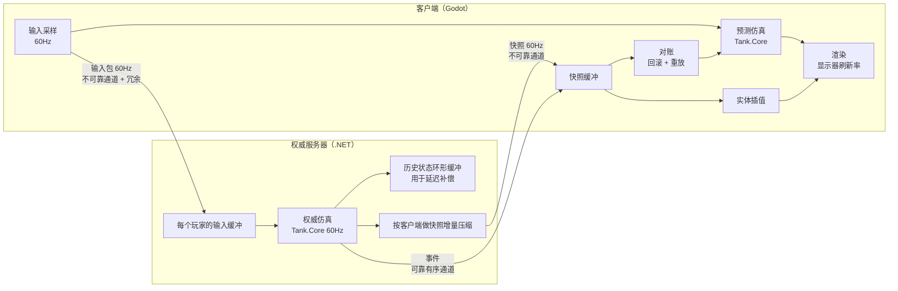
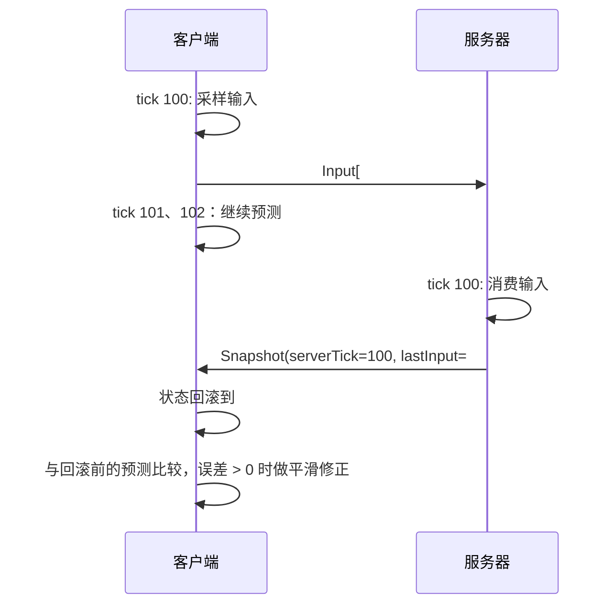
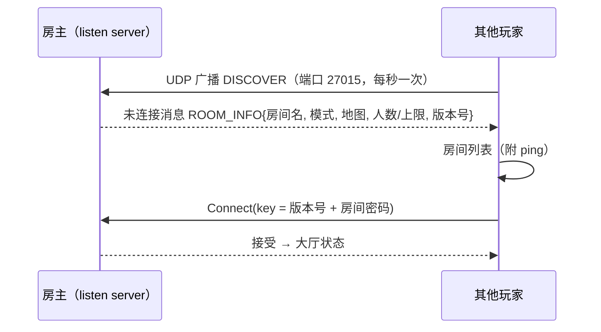

# 03 · 网络同步架构

目标：在局域网上达到 **CS 1.6 局域网服的手感**：自己操作零延迟，别人的动作平滑无抖，打中就是打中，偶尔丢包也看不出来。

## 1. 局域网上的卡顿从哪里来

有线局域网的往返延迟（RTT）通常 < 1ms，Wi-Fi 一般 2～10ms，但会偶发 50ms 以上的尖峰。**局域网卡顿的主因通常不是延迟**，而是下表这些：

| 卡顿来源 | 现象 | 对策（章节） |
|---|---|---|
| 等服务器确认后才移动 | 按键后有粘滞感 | 客户端预测（§4） |
| 收到包就直接设置位置 | 其他坦克一跳一跳 | 实体插值 + 抖动缓冲（§5） |
| 仿真频率与屏幕刷新率不一致 | 144Hz 屏上画面微抖 | 固定步长 + 渲染插值（§3.2） |
| 用 TCP 或可靠通道发位置 | 丢一个包，后面全被卡住（队头阻塞） | 位置走 UDP 不可靠通道，增量压缩基于已确认的快照（§7） |
| 预测出错后直接拉回 | 「瞬移」、「橡皮筋」 | 误差平滑（§4.3） |
| 开火要等服务器 | 开火延迟 | 子弹预测（§6.1） |
| 看到打中了，却判没中 | 「我明明打中了」 | 延迟补偿（§6.2） |
| GC 停顿、服务器 tick 不准 | 周期性卡顿 | 零分配热路径、高精度 tick 计时（§9） |
| Wi-Fi 丢包 | 偶发卡顿 | 输入冗余、自愈式增量快照、短时外推（§5.3, §7） |

## 2. 总体架构



- **服务器是唯一的事实来源**：客户端只上传**输入**（方向、开火），从不上传位置或命中结果。
- **服务器和客户端运行同一份 `Tank.Core` 代码**，保证预测结果与服务器一致。

### 2.1 参数总表（对照 CS 1.6）

| 参数 | CS 1.6 对应 | 本作默认值 | 说明 |
|---|---|---|---|
| 服务器 tick 频率 | `sys_ticrate` | **60Hz**（16.67ms） | 与原作 NES 的 60 帧逻辑一致，移动数值可以直接对照 |
| 输入发送频率 | `cl_cmdrate` | 60Hz，每包附带最近 **4** 条输入 | 冗余输入用于抗丢包 |
| 快照发送频率 | `cl_updaterate` | 60Hz | 局域网带宽充足 |
| 插值延迟 | `cl_interp` | **自适应**，默认 2 个 tick（33ms），范围 [1.5, 6] 个 tick | 根据实测抖动调整（§5.2） |
| 延迟补偿 | `sv_unlag` | 开启，最多回溯 200ms | §6.2 |
| 网络诊断面板 | `net_graph` | F3 | §10 |

## 3. 时间模型

### 3.1 Tick

- 所有逻辑以整数 `Tick` 计时（uint32，60Hz 下约 2 年才会溢出）。
- 服务器每个 tick 依次执行：读取各玩家对应该 tick 的输入 → `Simulation.Step()` → 存入历史 → 生成并发送快照。

### 3.2 客户端的固定步长与渲染插值

```text
accumulator += frameDelta
while accumulator >= TICK_DT:
    SampleInput(); SendInput(); PredictStep(); accumulator -= TICK_DT
alpha = accumulator / TICK_DT
Render(lerp(prevPredictedState, currPredictedState, alpha))   // 自己的坦克
Render(InterpolateSnapshots(renderTime))                      // 其他实体
```

- 仿真固定 60Hz，渲染跟随显示器（60/144/240Hz），用 `alpha` 在相邻两个 tick 之间插值，**高刷屏上也不会微抖**。
- 输入「锁存」：两个 tick 之间按下又松开的开火键不能丢失，用 `firePressedSinceLastTick` 标志位记录。

### 3.3 时钟同步：客户端要领先服务器

客户端在 tick `T` 产生的输入，必须在服务器仿真 tick `T` **之前**到达。因此客户端的预测时钟要领先服务器：

```text
clientTick ≈ serverTick + ceil((RTT + 输入缓冲余量) / TICK_DT)   // 快照到达时已晚 RTT/2，输入回去还要 RTT/2
```

- 每个快照携带 `serverTick`，以及「该玩家的输入到达时，距离被消费还早多少 tick」（`inputSlack`）。
- 客户端据此**微调时间流速**（time dilation，±2% 以内，借鉴 Overwatch）：`inputSlack` 过小就略微加速，过大就略微减速。目标让输入提前约 1 个 tick 到达。**不做突变跳 tick**，偏差超过 10 个 tick 时才硬同步。
- 局域网有线环境下，客户端实际领先服务器约 1～2 个 tick。

## 4. 客户端预测与服务器对账（自己的坦克）

### 4.1 流程



### 4.2 实现要点

- 客户端保存一个输入环形缓冲（最近 128 个 tick）：`InputCmd { Tick, Dir(3 bit), Fire(1 bit) }`。
- 预测**只模拟自己的坦克，以及自己发射的子弹**。与其他实体发生碰撞时，按它们**插值后的位置**做阻挡判定。
- 对账时把权威状态覆盖到本地，再重放尚未被确认的输入。因为 `Tank.Core` 用整数运算，绝大多数情况下误差**严格为 0**，不需要任何修正。

### 4.2.1 实测的拉回来源与对策

用 `Tank.Soak` 实测后发现并修复的问题：

| 来源 | 对策 |
|---|---|
| 刚炸开的缺口，客户端地图还没更新 | 预测改用「事件一到就应用」的预测地图（§7.4） |
| 对局结束后服务器停止仿真，客户端仍在预测（含冰面滑行惯性） | 收到 `Phase = Ended` 的快照后，预测视为冻结，且不再重放输入 |
| 与其他坦克贴身顶撞 | 对方位置来自略旧的快照，属于固有误差（CS 中玩家互相碰撞同理），交给 §4.3 平滑处理 |

### 4.3 误差平滑（防止「橡皮筋」）

预测出错时（例如被别人的坦克挡住、被冻结），逻辑位置立即修正，**画面位置**则保留一个偏移量，并在若干帧内衰减：

```text
visualOffset = oldPredictedPos - newPredictedPos     // 对账产生的跳变量
每帧: visualOffset *= exp(-dt / 0.06)                // 约 60ms 内消失
渲染位置 = 逻辑位置 + visualOffset
误差 > 1 tile 时直接瞬移（例如死亡、重生），不做平滑
```

## 5. 实体插值（其他坦克、AI、子弹）

### 5.1 原理

其他实体用**过去的时刻**渲染：`renderTime = 最新服务器时间 - interpDelay`。快照缓冲里总能找到夹住 `renderTime` 的前后两份快照，在它们之间做线性插值，画面绝对平滑。

### 5.2 自适应抖动缓冲

- 记录每份快照的到达时间间隔，计算抖动（取最近 2 秒的 P95）。
- `interpDelay = clamp(1 个 tick + 抖动P95 + 安全余量, 1.5 个 tick, 6 个 tick)`。
- 有线局域网通常稳定在约 25～33ms；Wi-Fi 出现抖动时自动升到 50～100ms，**宁可多延迟几毫秒也不卡**。
- `interpDelay` 的变化量按每秒至多 10% 平滑过渡，不让画面突然加速或减速。

### 5.3 丢包时的外推

- 如果 `renderTime` 超出了最新快照（连续丢包），按最后的速度向前**外推，最长 100ms**，之后原地停住，等待新快照。新快照到达后用 §4.3 的方式平滑回去。
- **子弹匀速直线运动**，外推结果完全正确。坦克只有四个移动方向，外推误差也很小。

### 5.4 「过去」和「现在」的混合

自己的坦克在「现在」（预测时间），别人在「过去」（插值时间）。两者之差约等于 RTT/2 + interpDelay，局域网下约 30～40ms。由此带来的命中偏差由 §6.2 的延迟补偿消除。

## 6. 战斗同步

### 6.1 开火预测

1. 客户端按下开火键：立刻生成**预测子弹**（本地 id = `输入序号`），播放炮口火光和音效，**零延迟**。
2. 服务器消费该输入时生成权威子弹，并在快照中带上 `spawnedByInput = 输入序号`。
3. 客户端收到快照后把预测子弹和权威子弹**配对**，切换为服务器 id 并继续预测。如果服务器判定这发子弹不存在（例如超出弹量上限、当时已死亡），淡出预测子弹。
4. **命中效果**：命中墙壁、地面的火花允许客户端预测；**击毁、扣血、砖墙破坏只看服务器**（局域网下最多晚 1～2 个 tick，人眼感知不到）。

### 6.2 延迟补偿（Favor the shooter）

坦克大战的子弹是有飞行时间的弹丸，不是 CS 那样的即时命中射线，因此采用「**逐子弹回溯**」：

- 客户端在每条输入中附带 `ViewDelta = 当前预测 tick − 当前插值渲染 tick`（4 bit，0～15），即「我开火时看到的其他人落后多少 tick」。
- 服务器生成子弹时记下 `LagTicks = min(ViewDelta, 12)`。
- 此后子弹每个子步做碰撞检测时：
  - 与**坦克**的碰撞，使用历史环形缓冲中 `当前 tick − LagTicks` 时刻的坦克包围盒，与射击者屏幕上看到的完全一致；
  - 与**墙体、老鹰、其他子弹**的碰撞使用当前状态（地形破坏不回溯，避免穿墙）。
- 回溯上限 12 tick（200ms），防止高延迟玩家「打到墙后的人」。局域网下通常只回溯 2～4 tick。
- 服务器历史环形缓冲保存最近 16 个 tick 的所有坦克位置（`TankHistory`）。
- AI 的子弹 `LagTicks = 0`。

> 与「子弹出生时快进」方案相比，逐子弹回溯在子弹整个飞行过程中都与射击者所见一致，实现也更简单。代码见 `Tank.Core/Systems/BulletSystem.cs`，测试见 `CombatTests.LagCompensation_*`。

### 6.3 判定规则（在服务器上，按 tick 内的固定顺序执行）

1. 应用所有玩家和 AI 的输入（移动、转向贴格）
2. 坦克之间碰撞阻挡（按实体 id 顺序处理，结果确定）
3. 子弹移动：以子步进方式移动，防止高速子弹穿透
4. 子弹对子弹（相互抵消）→ 子弹对墙 → 子弹对坦克 → 子弹对老鹰
5. 道具拾取、计时器、出生与重生
6. 生成事件和快照

**固定的执行顺序 + 整数运算 + 种子化随机数 = 可复现**，这是自动化测试和问题回放的基础。

## 7. 协议

### 7.1 通道划分（LiteNetLib DeliveryMethod）

| 通道 | 投递方式 | 内容 |
|---|---|---|
| 0 | `Unreliable` | 输入包（客户端→服务器）、快照（服务器→客户端） |
| 1 | `ReliableOrdered` | 事件：砖墙破坏、道具生成和拾取、击杀、比分、玩家加入和离开、聊天 |
| 2 | `ReliableOrdered` | 房间和对局控制：大厅状态、开局、关卡载入、完整地图同步 |
| — | 未连接消息（广播） | 局域网房间发现 |

> 事件都带 `tick` 字段，客户端在插值时间到达该 tick 时**才播放**，使爆炸与插值画面中的子弹消失严格同步，不会提前爆炸。

### 7.2 输入包（C→S，约 12 字节）

```text
u8   type = INPUT
u32  newestTick           // 本包最新一条输入的 tick
u32  ackSnapshotTick      // 客户端收到的最新快照，供服务器选择增量基准
u8   count (≤4)
count × { u4 dir(0=停 1↑ 2→ 3↓ 4←), u1 fire, u3 reserved }   // 从 newestTick 向前依次排列
```

服务器为每个玩家维护按 tick 索引的输入缓冲：重复到达的输入直接丢弃；该 tick 的输入没有到达时，**沿用上一条的方向，但不开火**，并累计到 `net_graph` 的「输入缺失」计数。

### 7.3 快照（S→C）

```text
u8   type = SNAPSHOT
u32  serverTick
u32  baseTick             // 增量基准：该客户端已确认的某份快照，0 表示完整快照
u32  lastProcessedInputTick
i8   inputSlack           // 用于时钟同步，见 §3.3
varint entityCount
entityCount × {
  varint id, u8 changedMask,
  [i16 x][i16 z][u2 dir][u8 hp][u8 flags][u16 spawnedByInput] ...  // 只发送变化的字段
}
varint removedCount, removedCount × varint id
```

- **增量压缩基于客户端已确认的快照**（Quake 3 模型）：中间丢失任何一份快照都不影响下一份解码，自动恢复，不需要重传。
- 服务器为每个客户端保存最近 64 份快照，用于计算增量。
- 全部字段都是整数，位打包后**单份快照约 100～400 字节**。8 名玩家、60Hz 下，每个客户端下行约 6～24KB/s，局域网完全无压力。
- 单包上限 1200 字节（低于常见 MTU）。超出时按优先级裁剪：自己附近的实体 > 子弹 > 远处实体，被裁掉的实体下一帧补发。

### 7.4 地图同步

- 进入对局时通过可靠通道下发完整地图：地形 + 砖墙微砖位图（32×32 tile × 16 cell / 8 ≈ 2KB）。
- 之后每次破坏是一条事件：`{tick, cellIndex 列表}`。客户端维护**两份**地图：
  - **预测地图**：事件一到就立即应用，供本地坦克的预测使用，避免「服务器上已经炸开的缺口，客户端还被旧砖挡住」造成的拉回；
  - **渲染地图**：在插值时间到达事件 tick 时才应用，让砖块碎裂和爆炸画面同步出现。
- 每 60 个 tick 在快照里带一个地图校验和（CRC32），不一致时请求重新同步，作为兜底。

## 8. 局域网房间与连接

### 8.1 发现



- 广播不可用时（例如路由器开启了 AP 隔离、访客网络），支持**手动输入 IP**。
- 握手时校验协议版本号，版本不一致直接拒绝，并给出明确提示。
- 首次运行时提醒用户在系统防火墙中放行游戏（Windows 会弹窗，文档中附截图）。

### 8.2 Listen server 与专用服务器

- 房主客户端在**独立线程**中运行 `Tank.Server`，与渲染线程互不阻塞。房主本地也通过 UDP 回环地址连接，**和其他人走完全相同的代码路径**（便于测试，房主没有特权）。
- 专用服务器：`dotnet Tank.Server.dll --mode coop --map 01 --port 27015`。

### 8.3 断线重连

- 连接时服务器下发 `sessionToken`。断开后 30 秒内保留玩家的坦克（原地无敌并闪烁），凭 token 重连时下发完整快照和地图，即可恢复。
- 房主退出时对局结束（本期**不做主机迁移**）。

## 9. 性能与防卡顿

| 位置 | 措施 |
|---|---|
| 服务器 tick 计时 | 用 `Stopwatch` 做高精度计时，「休眠 + 自旋」混合等待；Windows 上调用 `timeBeginPeriod(1)`。tick 落后时**补跑**（最多补 5 个），不跳 tick |
| 服务器 GC | 启用 `<ServerGarbageCollector>` 和 `GCSettings.LatencyMode = SustainedLowLatency` |
| 客户端热路径零分配 | 实体状态用 `struct` 数组；快照、输入缓冲是预分配的环形缓冲；序列化用 `Span<byte>`；子弹和特效对象池化。验收标准：对局中 `GC.CollectionCount(0)` 每分钟增量 ≈ 0 |
| 网络线程 | LiteNetLib 在自己的线程中收包，主线程在每帧开头 `PollEvents()` 统一处理；收到的数据先拷入预分配缓冲 |
| 渲染 | 微砖用 MultiMesh 渲染；开启垂直同步；材质与着色器在加载界面预热，避免首次爆炸时编译着色器造成卡顿 |
| 帧率目标 | 主流配置稳定在 ≥ 144fps，最低配置 ≥ 60fps |

## 10. 调试与诊断工具

1. **`net_graph`（F3）**：fps、ping、抖动、丢包率（上行和下行）、`interpDelay`、外推次数、预测误差次数、输入缺失次数、上下行带宽。
2. **网络模拟**：开发版的设置菜单直接调节 LiteNetLib 的 `SimulateLatency`、`SimulatePacketLoss`，以及自研的抖动注入。
3. **录像与回放**：服务器把「初始种子 + 地图 + 所有输入」写入文件，可以离线逐 tick 重放，并对比状态哈希。复现 bug 只需要一个录像文件。
4. **预测误差日志**：每次对账出现非零误差时，记录 tick、实体和误差向量。正常情况下应接近 0 次/分钟，数量偏高说明预测与服务器不一致。

## 11. 网络手感验收标准

| 场景 | 指标 |
|---|---|
| 有线局域网，8 人 | 自己的操作在下一帧显示；其他实体显示延迟 ≤ 35ms；肉眼看不到任何抖动；预测修正 ≤ 10 次/分钟（主要来自贴身碰撞，已平滑） |
| Wi-Fi，抖动 20ms、丢包 5%（模拟） | 无可见卡顿或瞬移；预测修正 ≤ 30 次/分钟 |
| 丢包 20%（模拟，极端） | 可以继续游玩，允许轻微外推痕迹，不断线 |
| 服务器 tick 耗时 | P99 < 2ms（8 人 + 8 个 AI + 40 发子弹） |
| 带宽 | 每个客户端下行 < 50KB/s |

### 11.1 当前实测结果（`dotnet run --project tests/Tank.Soak -c Release`）

8 个机器人，每个场景 60 秒，持续移动并高频开火（远比真人激烈）：

| 场景 | 预测修正/分钟/人 | 外推帧 | 快照/秒 | 下行 KB/s | 插值延迟 | 服务器 tick P99 | 掉线 |
|---|---|---|---|---|---|---|---|
| 有线局域网 | 4.5 | 0 | 60 | 6.5 | 30 ms | 0.08 ms | 0 |
| Wi-Fi 30±20ms、丢包 5% | 9.8 | 61 | 57 | 6.9 | 47 ms | 0.05 ms | 0 |
| 极差 60±40ms、丢包 20% | 25.5 | 539 | 49 | 6.9 | 59 ms | 0.03 ms | 0 |
| 合作 + AI，有线 | 17.2 | 0 | 60 | 3.8 | 30 ms | 0.02 ms | 0 |
