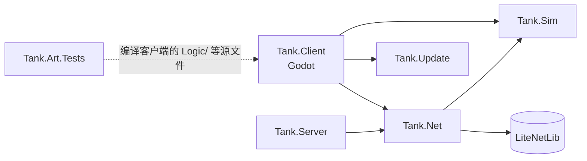

# 04 · 工程结构、测试与开发计划

## 1. 仓库结构

```text
BattleCity/
├── Tank.sln
├── global.json                    # .NET SDK 8.0.425 起（可用更高的 8.0）
├── Directory.Build.props          # net8.0、C# 12
├── Directory.Packages.props       # 统一管理 NuGet 包版本
├── build.json                     # 版本号和一句话说明（发布用）
├── src/
│   ├── Tank.Sim/                  # 玩法仿真：纯 C#，只引用基础库
│   │   ├── Geometry/              # Obb2、OrientedBox、Intersect、Angles、XorShift
│   │   ├── Terrain/               # HeightField（双线性采样、法线、射线求交）、TerrainGenerator
│   │   ├── Maps/                  # Battlefield（地形 + 物件 + 物件状态 + 地面和水）、PropIndex（物件网格索引）、MapData、Prop、WallLine、
│   │   │   │                      #   SurfaceMap、GroundSpeed、MapCatalog / MapDefinition（按名字取地图；NewNavGrid 每局拷一份导航网格）、
│   │   │   │                      #   SandboxMap、RiverlandMap、BotMapData（机器人的车道和掩护位，各地图类的 Bots）
│   │   │   ├── Building/          # 生成工具：ValueNoise、Polyline、DistanceGrid、HeightSculpt、PlacementGrid、PoissonDisc、Passability
│   │   │   └── Riverland/         # 河谷的布局和生成：地形、河湖、公路、地面类型、村镇、岩石、草丛、树
│   │   ├── Vehicles/              # TankSpec、TankCatalog、TankState、TankMotion、TankStep、TankPose、Concealment
│   │   ├── Combat/                # Dispersion、Ballistics、Armor、Penetration、WallDamage、ShotRandom、Shell
│   │   ├── Vision/                # Spotting（一次观察）、VisionTracker（按队汇总、保持 2 秒）
│   │   ├── Modes/                 # BattleMode、MatchRules、MatchEndReason（为什么结束）、SpawnLayout、
│   │   │                          #   TeamBase（标准战的基地）、BaseCapture（占领，按 tick 整数记）
│   │   ├── Navigation/            # NavGrid（4 m 通行网格）、PathFinder（A*、拉直）、PathService（一局的寻路排队和预算）、PathStatus、NavDisc
│   │   ├── Ai/                    # 对局机器人：BotDirector（一局一个：分工、回防、出命令）、Bot（一辆车）、TargetPicker（选目标）、
│   │   │                          #   Gunnery（提前量、下坠、俯仰）、BotSeating（开局的坐法和机器人种子）；PatrolDriver（试驾场 AI 靶车）、Steering
│   │   └── Simulation*.cs、InputCmd.cs、GameEvent.cs、SimConstants.cs
│   ├── Tank.Net/                  # 网络（引用 Tank.Sim 和 LiteNetLib）
│   │   ├── Protocol/              # BitWriter、BitReader、Channel、ProtocolException
│   │   ├── Transport/             # LiteNet 客户端 / 服务器传输、LoopbackNetwork（内存模拟网络）、LanDiscovery
│   │   ├── Timing/                # ServerRunner（服务器线程）、ClockSync（客户端时钟）
│   │   └── Battle/                # 协议、BattleServer、BattleClient、预测、插值、快照编解码、可见性、ServerMaps（每张图准备一次）
│   ├── Tank.Server/               # 无头专用服务器（Program.cs：参数解析、起服务器线程、等 Ctrl+C）
│   ├── Tank.Update/               # 在线升级：清单、签名校验、下载、替换脚本（不依赖 Godot）
│   └── Tank.Client/               # Godot 4 工程（project.godot + C#）
│       ├── scenes/                # Main.tscn（主场景）、Sandbox.tscn（试驾场，可直接启动）
│       ├── scripts/               # 见 §3
│       ├── shaders/               # 卡通着色器：地形（河谷的地面图层在这里）、远景地面、坦克、草、草丛、岩石、墙、树、房子、水面、基地的圈、天空、烟团
│       └── assets/fonts/          # 站酷快乐体和 OFL 许可证
├── tests/
│   ├── Tank.Sim.Tests/            # 仿真规则，含 ArchitectureTests（纯度检查）
│   ├── Tank.Net.Tests/            # 协议、服务器、客户端、预测、插值、发现、完整对局
│   ├── Tank.Art.Tests/            # 客户端里不依赖引擎的代码：网格库、各 Logic/ 目录、启动参数、调色板
│   ├── Tank.Update.Tests/         # 在线升级
│   ├── Shared/                    # Allocation.cs：零分配检查（重建场景最多量 3 次），链接进 Sim、Net、Art 测试
│   └── Tank.Soak/                 # 网络压测：服务器 + 4 客户端 + 4 机器人，四种模拟链路
├── tools/
│   ├── ship.sh                    # 测试、打包、建 GitHub Release、发更新源、改版本号
│   └── ci_release.sh              # 发布工作流的辅助步骤
├── .github/workflows/             # ci.yml（测试、soak、编译）、release.yml（改了 build.json 版本就自动发布）
└── docs/                          # 本目录；PROGRESS.md 是进度，superpowers/ 下是各阶段的设计和计划
```

## 2. 依赖方向



- **`Tank.Sim` 不依赖任何东西**：只引用基础库，不许用系统时间、`Stopwatch` 和 `System.Random`。`tests/Tank.Sim.Tests/ArchitectureTests.cs` 按程序集引用和字段类型检查（直接调用 `DateTime.Now` 查不出来，靠审查）。这样服务器和客户端预测跑的是同一份可重放的代码，测试也都可复现。
- **`Tank.Net` 不依赖 Godot**：`BattleServer`、`BattleClient` 在测试和 soak 里直接用。
- **客户端的 `Logic/` 目录不许 `using Godot`**：所有 `scripts/**/Logic/**` 和网格库 `Art/Mesh/**`，以及几个点名的文件（`Art/Palette.cs`、`Bootstrap/LaunchOptions.cs`、车辆外观数据等），由 `Tank.Art.Tests.csproj` 直接编译进测试项目。里面一旦用了 Godot 就编译不过。
- 客户端只负责显示和采集输入，**不做玩法判定**；试驾场在本地跑 `Simulation`，对局只读 `BattleClient`。

## 3. 客户端主要目录（`src/Tank.Client/scripts`）

| 目录 | 内容 |
|---|---|
| `Bootstrap/` | `Main`：根节点和界面流程（菜单 → 连接中 → 房间 → 对局 → 房间，试驾场作为子节点挂上）；`LaunchOptions`：唯一读启动参数的地方；`CaptureRun` 和 `Logic/ShotPlan`：脚本化截图、帧时间日志、定时退出 |
| `Online/Logic/` | `BattleSession`（一个会话：客户端加可选的房主后端）、`ThreadedHost`（房主服务器线程）、`LoopbackHost`（`--loopback` 的虚拟网络）、`LanBrowser`（房间列表）、`Reconnector`（断线重连）、`SeatTokens`（按规整过的房间地址在内存里记住重连令牌，从菜单再进时带上）、`AutoRoom`（按启动参数自动操作房间）、`TickProbe`（量服务器 tick 耗时） |
| `UI/` | `MenuScreen`（名字、开房间、试驾场、局域网列表、手填地址）、`RoomScreen`（模式、地图、机器人、车型、换队、准备、开局）、`UiKit`（按钮和文字样式）；`Logic/` 里是房间规则、名字截断和 `MapText`（地图名、窗口标题） |
| `Match/` | `MatchMain`：对局场景，每帧驱动 `BattleClient` 并画出它知道的一切；`TankActors`（别人的车）、`MatchInput`、`MatchHud`、比分板、击毁提示、计分板、结算、暂停层、F3 面板、`CaptureBarsView`（标准战比分板下的占领进度条）、`HudGallery`（`--hud-demo`）；`Logic/` 里是布局、文字、阵营色、观战状态、计分板模型、进度条和它的报警（`CaptureBars`） |
| `Sandbox/` | 试驾场：`SandboxMain`（本地跑 `Simulation`）、`TargetRange`（靶车）、`RangeDemo`（`--range-demo` 自动打靶）、`SandboxInput`、`SandboxHud`；`Logic/MapSites`（每张图的站点：出生点、靶车、有没有巡逻车、机位锚点和可用的机位、演示，对局的固定机位也从这里取）、`Logic/RiverlandDemos`（河谷的演示） |
| `World/` | `BattleWorld`：天空、地形网格（32 × 32 格一块，河谷用层叠的地面图层）、`WaterSurface`（水面，只建在有水的格子上）、岩石、草丛、墙和栅栏、`ForestViews`（林中的树，按扇区的 `MultiMesh`，倒下动画）、`HouseViews`（房子、倒塌、废墟）、`BaseRings`（标准战地上的两个基地圈，带宽和实线在 `Logic/RingBand`）、地面小草、外围树林；物件状态变了才全量同步瓦砾、倒下的栅栏和没了的草丛；树和房子挡住自己的车时变半透明（`Logic/SeeThroughFades`） |
| `Vehicles/` | `TankModel`（程序化的玩具坦克）、`TankActor`（模型 + 残骸黑烟 + 扬尘）、外观数据、履带滚动和车体点头、炮管后坐、击毁时飞起的炮塔 |
| `Combat/` | 炮口火光和爆炸、曳光（这两样池化，不在每发炮弹时分配）、物件被毁的碎块、扬尘、残骸黑烟；涉水的水花和落水的水柱（`Logic/SplashRules`，特效自己找 `WaterSurface` 查水深） |
| `Overlay/` | `CombatHud`（试驾场和对局共用）：准星、状态面板（含地面提示 `Logic/GroundText`）、命中大字和伤害数字、血条和名字、狙击镜暗角、点亮调试文字 |
| `Driving/` | `DriveInput`（驾驶和开火键，运行时注册）、`AimSolver` + `Logic/AimMath`（屏幕中心 → 瞄准角）、`Logic/FireLatch`（开火锁存） |
| `Cameras/` | `OrbitCamera`（第三人称和狙击镜）、`CameraPresets`（截图和测帧用的固定机位） |
| `Art/` | `Palette`（全部颜色）、`Materials`（加载着色器）、`Mesh/`（网格库：挤出、旋转体、圆角板、岩石、草丛、树、墙、房子、水面、贴地的圆环带 `RingMesh`、地面图层贴图、扇区网格等） |
| `Update/` | `UpdateService`：把 `Tank.Update` 接到引擎上，只在正式包里启用 |

## 4. 核心数据流

**服务器每 tick**（30 Hz，见 [03 §3.1](03-netcode.md#31-服务器的一个-tick)）：收包 → 机器人 `BotDirector.Update` → 每辆车的输入（真人的输入缓冲 / 机器人的 `BotDirector.Command`）→ `Simulation.Step` → `VisionTracker.Update` → `MatchRules.Update` → 每个客户端：过滤事件、建快照、发送。

**机器人**（`Ai/`、`Navigation/`，规则见 [01 §2.3](01-game-design.md#23-机器人)）：服务器开局时用 `BotSeating` 坐好机器人（抽车型、进人少的队、各自的种子），建这一局的 `BotDirector`（拷一份地图准备时建好的 `NavGrid`）、加机器人、分工，整局都建好了才交给服务器。`BotDirector.Update` 每 tick 一次：上一步的事件里倒下的物件进网格（`PathService.Refresh`；漏了 tick 时 `Sync` 整体补算），命中进各机器人的 `TargetPicker`，复活的重新开始这一段；标准战里查回防、解除和全队压上；`PathService.Observe` 记下残骸和站着不动的车；`PathService.Run` 用这一 tick 的 3000 次扩展。然后每个机器人的 `Command`：取回寻路结果、后撤、选目标、开车或交战，给出一条 `InputCmd`。这两步开局后不分配；只用种子随机数和仿真状态，按车号排队。

**`Simulation.Step` 内部**：先报上一步之后挂起的事件（复活）；记下所有车的占地；每辆活着的车按槽位顺序 `TankStep.Advance`（清洗输入、车体转向、行驶和撞物件、瞄准、散布、装填、开炮），碰撞对照的是这一 tick 开头别的车的位置，所以结果不依赖槽位；最后是炮弹阶段：炮管顶在障碍物里的炮弹就地爆炸，其余每发飞一步、结算命中。

**客户端每帧**（`MatchMain._Process`）：

```text
session.Advance(dt)                                 // 回环主机在这里推进虚拟网络和服务器
cmd = 输入（油门、转向、瞄准角、开火、弹种）；阵亡、暂停、结算时只留瞄准
client.Update(dt, cmd)                              // 预测、对账、插值、事件、炮弹，见 03 §3.2
事件 → 特效和 HUD（开炮、爆炸、命中字、击毁、物件被毁）
自己的车：Predictor 的上一 tick / 这一 tick 按 Clock.Alpha 插值 + 平滑偏移
别人的车：client.Others（插值后）；炮弹：client.Shells
镜头 → 瞄准角（AimSolver）→ 世界、车、炮弹、HUD 刷新 → 截图自动化
```

三个时间域不要混：自己的车在“现在”（领先服务器），别人的车在“过去”（约 100 ms），炮弹在客户端 tick 上步进。

**试驾场**：`SandboxMain` 自己攒时间，按 30 Hz 步进本地的 `Simulation` 和 `VisionTracker`，晚一个 tick 插值显示；没有网络。

## 5. 测试

全部测试不需要 Godot，`dotnet test` 就能跑。CI（`.github/workflows/ci.yml`）推到 main 和每个 PR 都跑四个测试项目（收集覆盖率，没有门禁）、soak，再编译专用服务器和客户端程序集。

| 项目 | 内容 | 例子 |
|---|---|---|
| `Tank.Sim.Tests` | 仿真的每条规则：地形采样和求交、平地和坡上的运动、爬坡上限、碰撞、弹道、装甲盒求交、击穿和跳弹的边界、高爆弹衰减、散布、墙和草丛被毁、撞墙、点亮公式和视线、四种模式的规则和结束原因、出生点和路点、架构纯度；导航（网格的代价和关格、物件倒下只重算周围且只会变通变便宜、和重建相同；A\* 和 Dijkstra 代价一致、分次搜索结果相同、网格变化时接着搜、拉直后离障碍 ≥ 2.5 m 且不超过原路 5%、绕开残骸和停着的车；排队按车号、每 tick 预算；两张图的车道和掩护位、所有要去的点连通）；机器人（提前量和下坠、炮打不着时瞄炮塔、选目标的顺序和保持、视线和残骸、只打本队看得见的、400 m；沿路开、每 5 秒重算、卡住倒车、放弃一段；分工、回防和解除、占领点、后撤、全队压上；穿甲打光打高爆、太近时倒退；让开队友；坐法；整局（两张图上十个机器人，河谷上九个机器人加一个不动的真人；坐法和服务器相同）：10 分钟内结束、没有机器人原地卡住 10 秒、每张图至少一局有基地得过分、河谷上两队的进攻车都进过对方基地圈、河谷的固定种子里有一局以占领结束，逐位重放，每 tick 零分配）；标准战（两张图的基地：半径、离本队出生区 40～80 m、平地干地、空旷、两队开得到、间距；占领：每秒 1 分、3 辆上限按车号、挨打和阵亡清零、守军暂停、离圈保留、满 100 不早一 tick、同 tick 双胜平局；两张真图上全歼、占领、10 分钟超时三种结束，十个机器人每 tick 零分配）；物件网格索引（随机查询和全表扫描相同；试驾场地图、密集场地、合成树林、林中房子上开关索引逐 tick 相同；河谷上的查询不超出缓冲的一半）；地面和水的速度系数；树和房子（撞倒、撞塌、打塌发数、遮挡、废墟、恢复）；试驾场地图的指纹不变；河谷的生成（确定、水、公路、房子、树、岩石、草丛、出生点和路点的间距与连通、靶车的意图、Release 下的耗时上限） | `PenetrationTests`、`SpottingTests`、`MatchRulesTests`、`NavGridTests`、`PathFinderTests`、`PathServiceTests`、`NavObstacleTests`、`MapBotDataTests`、`GunneryTests`、`TargetPickerTests`、`BotDriveTests`、`BotFireTests`、`BotObstacleTests`、`BotRoleTests`、`BotMateTests`、`BotSeatingTests`、`BotMatchTests`、`PropIndexEquivalenceTests`、`GroundDrivingTests`、`TreeTests`、`HouseRamTests`、`SandboxFingerprintTests`、`RiverlandTerrainTests`、`RiverlandSpawnTests`、`RiverlandPerformanceTests`、`MapBaseTests`、`BaseCaptureTests`、`StandardRulesTests`、`StandardMatchTests` |
| `Tank.Net.Tests` | 位流；输入、快照（完整和增量）、事件、地图、房间消息的编码往返和截断乱包；v3 地图（地面、水、新物件）和各项上限；可见性裁剪（字节流里搜不到看不见的敌人）；预测和对账（完美网络零修正、坏网络下有上限并收敛）；插值；时钟同步；发现；回环网络下四种模式各打完一局；河谷和一张混合小地图上的对局（开局消息 < 1 MiB、开过水沙路和撞倒树零修正、撞树撞房后服务器和客户端的物件状态一致），真 UDP 上的河谷开局；选地图（只有房主、对局中不能设、生成中和失败时不能开局）、地图只准备和编码一次、重同步不重发地图；不可靠包上限；断线重连、中途加入、版本不符、房间已满；服务器每 tick 零分配；协议 v4（基地分数、结束原因、占领、开局消息的基地的往返，越界和截断报错，满员标准战快照小于不可靠包上限，别的版本的房间带不认识的模式照样列出）；标准战服务器（开局要基地、看不见进攻车也收到基地分数、敌方占领分结束后才发、中途加入、一人一局一辆车、宽限内回来拿回原车、只剩等着的人时结束、河谷带机器人打完）；服务器上的机器人（开局分工和 `bots:` 日志、沿车道走、没有机器人数据的地图照样进攻、结束摘要每局只记一次、机器人起不来时房间不变、中途进出、每局按房间的机器人数、同一种子重放、服务器和测试的整局 30 秒逐位相同；9 个机器人时服务器每 tick p99 < 2 ms，量到对局结束） | `BattleIntegrationTests`、`BattleServerTests`、`ClockSync30Tests`、`MapWireV3Tests`、`RiverlandMatchTests`、`RoomMapTests`、`ServerMapTests`、`UnreliableLimitTests`、`StandardWireTests`、`StandardServerTests`、`BotServerTests`、`BotLoadTests` |
| `Tank.Art.Tests` | 网格库的各种形状、调色板和着色器默认值一致、车辆外观数据、HUD 布局（1600×900、1600×1200、2100×900）、启动参数解析、房间规则、观战状态、重连逻辑、房主线程；`--map` 和每张图的站点（机位锚点在图内）、地面图层贴图和着色器一致、水面网格在岸线处水深为 0、倒树姿态、房子填满长方体、地面提示文字、水花规则、河谷演示在无画面的仿真里的结果、房间里的地图选择；标准战的文字（比分板、七种结算原因）、占领进度条和报警、计分板的占领格、基地圈的网格和带宽、圈和进度条按两队的颜色、重连令牌的地址规整 | `HudLayoutTests`、`LaunchOptionsTests`、`ReconnectorTests`、`MapSitesTests`、`GroundLayersTests`、`WaterMeshTests`、`HouseShapesTests`、`RiverlandDemoTests`、`StandardHudTextTests`、`CaptureBarsTests`、`RingMeshTests`、`RingBandTests`、`SeatTokensTests` |
| `Tank.Update.Tests` | 版本比较、清单解析和签名校验、解包（含防路径穿越）、找安装目录、替换和失败回退 | `UpdaterTests`、`ManifestAndSignatureTests` |
| `Tank.Soak` | 4 个脚本客户端 + 4 个机器人，试驾场地图上的团队对战，四种模拟链路各 60 秒，超标就非零退出 | 验收表见 [03 §11](03-netcode.md#11-网络手感验收标准) |

计墙钟时间的测试放在不并行的 `Timing` 集合里（Sim 和 Net 各一个），等并行的测试跑完再跑。零分配测试共用 `tests/Shared/Allocation.cs`：偶尔有一个测量窗口里量到几 KB 不是被测代码分配的运行时噪声，所以每次重建整个场景、最多量 3 次，有一次为 0 就算过；真的每 tick 分配三次都会失败。2026-10-27 的测试数：Sim 1100、Net 294、Art 1137、Update 42。

**Godot 截图自动化**：画面相关的改动靠启动参数跑出截图人工比对（参数全表在 `Bootstrap/LaunchOptions.cs` 文件头）：

- `--screenshot FILE --screenshot-at S`：S 秒后截一张；`--shot-after fire|hit|kill|prop|down|death|ended:S`：某件事第一次发生后 S 秒截；`--quit-after S` 定时退出；
- `--loopback --seed N --autodrive`：房主用虚拟网络和固定步长，自动开车开炮，同一个命令每次打出同一局；
- `--hud-demo NAME`：HUD 画廊，用预制数据在纯色底上画 HUD 的各种状态（`timer`、`feed`、`respawn`、`spectate`、`scoreboard`、`results-win` 等；标准战是 `standard`：进行中的比分板、两条进度条和计分板，`capture`：占领获胜的结算）；
- 试驾场：`--sandbox`、`--map sandbox|riverland`（用哪张图，默认试驾场地图；开房时它定房间的地图，默认河谷；写错时警告并用默认的）、`--camera-preset NAME`（固定机位；河谷另有 `overview`、`town`、`ford`、`forest`、`plateau`、`dunes` 和正上方正交俯视的 `map`；两张图都有对着基地、从本队一侧看的 `base0`、`base1`（45 m 外、30 m 高）、`base0near`、`base1near`（30 m 外、4 m 高，坦克的高度）、`base0far`、`base1far`（坦克在离圆心 46 m 处时的跟车视角）；圈只在标准战对局里画，所以配 `--host --mode standard` 用）、`--range-demo NAME`（自动打靶、撞墙、看点亮；河谷是 `house`、`ram-house`、`trees`、`ford`）、`--fps-log`（每秒打印帧时间）。试驾场地图专有的机位和演示在河谷上不可用，会给出警告。

**打包冒烟**：`tools/ship.sh build` 在 macOS 上把导出的游戏启动一次（`--headless -- --host --port 27091 --bots 1 --autostart --quit-after 10`），日志里要同时有“[server] match started”和“[match] entered match”，才算打包成功。

**人工验收**：每个阶段结束时用户试玩。联网的手动清单见 [阶段 4 联网设计 §7.3](superpowers/specs/2026-10-18-stage4-networking-design.md)。

## 6. 阶段路线

| 阶段 | 内容 | 状态 |
|---|---|---|
| 1 单机试驾场 | `Tank.Sim` 骨架、高度图地形、中坦的运动和爬坡、炮塔跟随瞄准、弹道；试驾场场景、第三人称和狙击镜 | ✅ |
| 1.5 画面 | 卡通风格、玩具坦克、土色地面和草岛、高草丛、更多掩体 | ✅ |
| 2A 战斗核心 | 血量、装甲盒、击穿和跳弹、高爆弹、散布和缩圈、换弹种、靶车、命中提示 | ✅ |
| 2B 车型 | 轻坦、重坦、TD；平衡装填和伤害；试驾场换车 | ✅ |
| 2C 可破坏物 | 墙、栅栏、草丛被毁，瓦砾，重坦撞墙 | ✅ |
| 3 点亮 | 发现距离、隐蔽、草丛、开火暴露、视线；AI 靶车；“被点亮”灯 | ✅ |
| 4 联网 | 4A 联网核心（规则、机器人、协议、服务器、无头客户端、soak）；4B 客户端对局（菜单、房间、对局画面、HUD、观战、重连）；4C 删除旧代码、整理、改写文档 | ✅ |
| 5A 河谷地图 | 1200 m 的河谷（台地、山、沙丘、河、湖、浅滩、公路、村镇、五片树林）；地面类型和浅水影响车速；树和房子；物件网格索引；协议 v3（地图带地面和水）；房间里选地图、新房间默认河谷、`Tank.Server --map`；客户端的地面图层、水面、树林、房子、水花、地面提示 | ✅ |
| 5B 标准战 | 第四种模式 `standard`：两队基地（半径 25 m，河谷相距 983 m）、占领（按 tick 整数记，圈内进攻车每秒 +1 分，最多按 3 辆车号最小的算，守军暂停，挨打清零，满 100 分赢）、全歼或占领获胜、限时 10 分钟、可以中途加入；协议 v4（基地分数、结束原因、每人的占领分、开局带基地）；不复活的模式里一人一局一辆车（按重连令牌）；进度条、计分板“占领”列、结算原因、地上的圈；`Tank.Server --mode standard`。机器人还不会占领和回防（5C） | ✅ |
| 5C 机器人 | 寻路（4 m 通行网格、A\*、拉直、每 tick 3000 次扩展的共享预算、绕开残骸和停着的车）；标准战分工（TD 守家最多 2 个、按车道进攻、轻坦走侧翼、进圈后各自停在占领点上）、回防、全队压上、残血后撤；交战（只用本队看得见的、400 m、视线、3 秒内打过我 > 血量比例 > 距离、保持 2 秒、提前量和下坠、停车开火）；让开队友；两张图的车道和掩护位；服务器的机器人换成 `BotDirector`（原来直线开向路点的简单机器人删掉）；9 个机器人时服务器每 tick p99 约 0.2 ms | ✅ |
| 5D 小地图 | 右下角小地图，按 M 放大成全屏 | 未开始 |
| 6 吃鸡 | 1000 m 大地图；毒圈分阶段收缩；补给箱（维修、弹药、加固装甲、快速装填、光学设备）；最多 16 人；排名结算 | 未开始 |

阶段 5 的设计见 [阶段 5 设计](superpowers/specs/2026-10-22-stage5-design.md)（5A 照 [河谷设计](superpowers/specs/2026-10-19-riverland-map-design.md) 做）；6 的设想见 [总体设计](superpowers/specs/2026-10-13-third-person-tank-design.md) §3、§7、§12，开工前另写设计。每个阶段的做法：先写设计、用户确认；做草稿并截图验证；审查后导出实施计划；按计划逐批实现、每批审查；验收、用户试玩；squash 合入 main。进度和下一步记在 [PROGRESS.md](PROGRESS.md)。

## 7. 编码约定（摘要）

- `Tank.Sim` 保持纯净（§2）；新的仿真规则先写测试。
- 客户端里不依赖引擎的逻辑放进 `Logic/` 子目录，在 `Tank.Art.Tests` 里测。
- 每帧、每 tick 都跑的热路径不用 LINQ、不 `new` 引用类型、不用闭包；服务器有“对局中每 tick 零分配”的测试。
- 网络数据不可信：解码出错只抛 `ProtocolException`，丢掉那个包，不让异常逃出客户端或服务器；有模糊测试。
- 文件 200～400 行为宜，最多 800 行；函数不超过 50 行。
- 新代码只用 `Art/Palette` 的颜色；HUD 用 1600×900 基准单位。
- 提交信息用 Conventional Commits（`feat:`、`fix:`、`refactor:`、`docs:` ……）；文档和界面文字用中文。

## 8. 风险与对策

| 风险 | 影响 | 对策 |
|---|---|---|
| 不同平台的浮点结果有末位差别 | 地图对不上、预测偏差 | 地图由服务器发；只用 `MathF` 基础运算；对账平滑修正；自己的车用 32 位浮点下发 |
| 预测不撞倒物件 | 撞栅栏、砖墙时偶尔约 1 m 的拉回；撞塌房子后要等物件状态到了才按废墟减速 | 已知，只在撞物件时出现；试玩时看 F3 的“最大” |
| 地图体积 | 河谷的开局消息约 555 KB，每次都发整张图会占带宽、拖慢开局 | 每张图只编码一次、拷进每个座位的开局消息；走可靠通道；同一局的重同步不重发地图（只发十来个字节，再加上变了的物件状态）；测试要求 < 1 MiB |
| 地图生成耗时 | 河谷生成要上百毫秒（Release 实测 60～130 ms，Debug 约 0.4 s），在 tick 线程上做会卡住所有人 | 真房间在后台线程生成，房间先开、地图好了才能开局（“地图生成中…”）；每张图一个进程只生成一次；开局复制准备好的场地（约 0.1 ms）；Release 下生成 ≤ 1.5 s 的测试 |
| 物件多了画面变慢 | 河谷约 5600 个物件，掉帧 | 仿真查询用网格索引；树按扇区分组、远处淡出、近处才投影；物件状态变了才全量同步；实测河谷约 120～130 帧（GPU 受限），目标 ≥ 60 |
| Wi-Fi 抖动和丢包 | 别人的车卡顿 | 自适应插值延迟 + 短时外推；soak 的 Wi-Fi 和糟糕链路都通过 |
| GC 停顿 | 周期性卡顿 | 热路径零分配，服务器线程低延迟 GC；分配测试 |
| 广播被路由器屏蔽、改了端口 | 找不到房间 | 手填“地址:端口” |
| 系统防火墙拦截 | 连不上 | 首次运行时放行 UDP 27015 |
| 房主掉线 | 对局结束 | 不做房主迁移；可以用专用服务器；短暂卡住能用房主令牌重连 |
| 阶段 6 的 16 人和大地图 | 点亮计算（两两观察）和带宽上升 | 点亮已是 5 Hz 且有快速判定；到时用 soak 量化 |
| AI 工作量被低估 | 阶段 5 拖期 | 先做了“路点巡逻 + 看见就打”的最小版本，寻路、分工、交战放在 5C 单独做，只做中等档（不做找掩体、按车型的打法、侦察）；寻路按扩展次数限预算，服务器 tick 有 9 个机器人的计时测试 |
| 版权和商标 | 不能公开发布 | 游戏名 Tank 3D，玩法、美术、地图都是原创；只有仓库名里有 Battle City；字体是 OFL 许可 |
| 以后要支持公网 | 延迟上升 | 预测、插值、按可见性发快照都适用于公网；需要再加 NAT 穿透或中继 |
