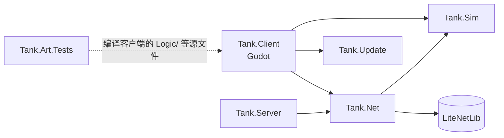

# 04 · 工程结构、测试与开发计划

## 1. 仓库结构

```text
BattleCity/
├── Tank.sln
├── global.json                    # 锁定 .NET SDK 8.0.4xx
├── Directory.Build.props          # net8.0、C# 12
├── Directory.Packages.props       # 统一管理 NuGet 包版本
├── build.json                     # 版本号和一句话说明（发布用）
├── src/
│   ├── Tank.Sim/                  # 玩法仿真：纯 C#，只引用基础库
│   │   ├── Geometry/              # Obb2、OrientedBox、Intersect、Angles、XorShift
│   │   ├── Terrain/               # HeightField（双线性采样、法线、射线求交）、TerrainGenerator
│   │   ├── Maps/                  # Battlefield（地形 + 物件 + 物件状态）、MapData、Prop、WallLine、SandboxMap
│   │   ├── Vehicles/              # TankSpec、TankCatalog、TankState、TankMotion、TankStep、TankPose、Concealment
│   │   ├── Combat/                # Dispersion、Ballistics、Armor、Penetration、WallDamage、ShotRandom、Shell
│   │   ├── Vision/                # Spotting（一次观察）、VisionTracker（按队汇总、保持 2 秒）
│   │   ├── Modes/                 # BattleMode、MatchRules、SpawnLayout
│   │   ├── Ai/                    # SkirmishBot（对局机器人）、PatrolDriver（试驾场 AI 靶车）、Steering
│   │   └── Simulation*.cs、InputCmd.cs、GameEvent.cs、SimConstants.cs
│   ├── Tank.Net/                  # 网络（引用 Tank.Sim 和 LiteNetLib）
│   │   ├── Protocol/              # BitWriter、BitReader、Channel、ProtocolException
│   │   ├── Transport/             # LiteNet 客户端 / 服务器传输、LoopbackNetwork（内存模拟网络）、LanDiscovery
│   │   ├── Timing/                # ServerRunner（服务器线程）、ClockSync（客户端时钟）
│   │   └── Battle/                # 协议、BattleServer、BattleClient、预测、插值、快照编解码、可见性
│   ├── Tank.Server/               # 无头专用服务器（Program.cs：参数解析、起服务器线程、等 Ctrl+C）
│   ├── Tank.Update/               # 在线升级：清单、签名校验、下载、替换脚本（不依赖 Godot）
│   └── Tank.Client/               # Godot 4 工程（project.godot + C#）
│       ├── scenes/                # Main.tscn（主场景）、Sandbox.tscn（试驾场，可直接启动）
│       ├── scripts/               # 见 §3
│       ├── shaders/               # 卡通着色器：地形、坦克、草、草丛、岩石、墙、树、天空、烟团
│       └── assets/fonts/          # 站酷快乐体和 OFL 许可证
├── tests/
│   ├── Tank.Sim.Tests/            # 仿真规则，含 ArchitectureTests（纯度检查）
│   ├── Tank.Net.Tests/            # 协议、服务器、客户端、预测、插值、发现、完整对局
│   ├── Tank.Art.Tests/            # 客户端里不依赖引擎的代码：网格库、各 Logic/ 目录、启动参数、调色板
│   ├── Tank.Update.Tests/         # 在线升级
│   └── Tank.Soak/                 # 网络压测：服务器 + 4 客户端 + 4 机器人，四种模拟链路
├── tools/
│   ├── ship.sh                    # 测试、打包、建 GitHub Release、发更新源、改版本号
│   └── ci_release.sh              # 发布工作流的辅助步骤
├── .github/workflows/             # ci.yml（测试、soak、编译）、release.yml（改了 build.json 版本就自动发布）
└── docs/                          # 本目录；PROGRESS.md 是进度，superpowers/ 下是各阶段的设计和计划
```

## 2. 依赖方向



- **`Tank.Sim` 不依赖任何东西**：只引用基础库，不许用系统时间、`Stopwatch` 和 `System.Random`。`tests/Tank.Sim.Tests/ArchitectureTests.cs` 检查。这样服务器和客户端预测跑的是同一份可重放的代码，测试也都可复现。
- **`Tank.Net` 不依赖 Godot**：`BattleServer`、`BattleClient` 在测试和 soak 里直接用。
- **客户端的 `Logic/` 目录不许 `using Godot`**：所有 `scripts/**/Logic/**` 和网格库 `Art/Mesh/**`，以及几个点名的文件（`Art/Palette.cs`、`Bootstrap/LaunchOptions.cs`、车辆外观数据等），由 `Tank.Art.Tests.csproj` 直接编译进测试项目。里面一旦用了 Godot 就编译不过。
- 客户端只负责显示和采集输入，**不做玩法判定**；试驾场在本地跑 `Simulation`，对局只读 `BattleClient`。

## 3. 客户端主要目录（`src/Tank.Client/scripts`）

| 目录 | 内容 |
|---|---|
| `Bootstrap/` | `Main`：根节点和界面流程（菜单 → 连接中 → 房间 → 对局 → 房间，试驾场作为子节点挂上）；`LaunchOptions`：唯一读启动参数的地方；`CaptureRun` 和 `Logic/ShotPlan`：脚本化截图、帧时间日志、定时退出 |
| `Online/Logic/` | `BattleSession`（一个会话：客户端加可选的房主后端）、`ThreadedHost`（房主服务器线程）、`LoopbackHost`（`--loopback` 的虚拟网络）、`LanBrowser`（房间列表）、`Reconnector`（断线重连）、`AutoRoom`（按启动参数自动操作房间）、`TickProbe`（量服务器 tick 耗时） |
| `UI/` | `MenuScreen`（名字、开房间、试驾场、局域网列表、手填地址）、`RoomScreen`（模式、机器人、车型、换队、准备、开局）、`UiKit`（按钮和文字样式）；`Logic/` 里是房间规则和名字截断 |
| `Match/` | `MatchMain`：对局场景，每帧驱动 `BattleClient` 并画出它知道的一切；`TankActors`（别人的车）、`MatchInput`、`MatchHud`、比分板、击毁提示、计分板、结算、暂停层、F3 面板、`HudGallery`（`--hud-demo`）；`Logic/` 里是布局、文字、阵营色、观战状态、计分板模型 |
| `Sandbox/` | 试驾场：`SandboxMain`（本地跑 `Simulation`）、`TargetRange`（靶车）、`RangeDemo`（`--range-demo` 自动打靶）、`SandboxInput`、`SandboxHud` |
| `World/` | `BattleWorld`：天空、地形网格（32 × 32 格一块）、岩石、草丛、墙和栅栏、地面小草、外围树林；每帧按物件状态显示瓦砾、倒下的栅栏和没了的草丛 |
| `Vehicles/` | `TankModel`（程序化的玩具坦克）、`TankActor`（模型 + 残骸黑烟 + 扬尘）、外观数据、履带滚动和车体点头、炮管后坐、击毁时飞起的炮塔 |
| `Combat/` | 炮口火光和爆炸、曳光（这两样池化，不在每发炮弹时分配）、物件被毁的碎块、扬尘、残骸黑烟 |
| `Overlay/` | `CombatHud`（试驾场和对局共用）：准星、状态面板、命中大字和伤害数字、血条和名字、狙击镜暗角、点亮调试文字 |
| `Driving/` | `DriveInput`（驾驶和开火键，运行时注册）、`AimSolver` + `Logic/AimMath`（屏幕中心 → 瞄准角）、`Logic/FireLatch`（开火锁存） |
| `Cameras/` | `OrbitCamera`（第三人称和狙击镜）、`CameraPresets`（截图和测帧用的固定机位） |
| `Art/` | `Palette`（全部颜色）、`Materials`（加载着色器）、`Mesh/`（网格库：挤出、旋转体、圆角板、岩石、草丛、树、墙等） |
| `Update/` | `UpdateService`：把 `Tank.Update` 接到引擎上，只在正式包里启用 |

## 4. 核心数据流

**服务器每 tick**（30 Hz，见 [03 §3.1](03-netcode.md#31-服务器的一个-tick)）：收包 → 每辆车的输入（真人的输入缓冲 / 机器人）→ `Simulation.Step` → `VisionTracker.Update` → `MatchRules.Update` → 每个客户端：过滤事件、建快照、发送。

**`Simulation.Step` 内部**：先报上一步之后挂起的事件（复活）；记下所有车的占地；每辆活着的车按槽位顺序 `TankStep.Advance`（清洗输入、车体转向、行驶和撞物件、瞄准、散布、装填、开炮），碰撞对照的是这一 tick 开头别的车的位置，所以结果不依赖槽位；最后是炮弹阶段：炮管顶在障碍物里的炮弹就地爆炸，其余每发飞一步、结算命中。

**客户端每帧**（`MatchMain._Process`）：

```text
session.Advance(dt)                                 // 回环主机在这里推进虚拟网络和服务器
cmd = 输入（油门、转向、瞄准角、开火、弹种）；阵亡、暂停、结算时只留瞄准
client.Update(dt, cmd)                              // 预测、对账、插值、事件、炮弹，见 03 §3.2
事件 → 特效和 HUD（开炮、爆炸、命中字、击毁、物件被毁）
自己的车：Predictor 的上一 tick / 这一 tick 按 Clock.Alpha 插值 + 平滑偏移
别人的车：client.Others（插值后）；炮弹：client.Shells
镜头 → 瞄准角（AimSolver）→ 世界、车、炮弹、HUD 刷新 → 截图自动化
```

三个时间域不要混：自己的车在“现在”（领先服务器），别人的车在“过去”（约 100 ms），炮弹在客户端 tick 上步进。

**试驾场**：`SandboxMain` 自己攒时间，按 30 Hz 步进本地的 `Simulation` 和 `VisionTracker`，晚一个 tick 插值显示；没有网络。

## 5. 测试

全部测试不需要 Godot，`dotnet test` 就能跑。CI（`.github/workflows/ci.yml`）每次推送和 PR 都跑四个测试项目（收集覆盖率，没有门禁）、soak，再编译专用服务器和客户端程序集。

| 项目 | 内容 | 例子 |
|---|---|---|
| `Tank.Sim.Tests` | 仿真的每条规则：地形采样和求交、平地和坡上的运动、爬坡上限、碰撞、弹道、装甲盒求交、击穿和跳弹的边界、高爆弹衰减、散布、墙和草丛被毁、撞墙、点亮公式和视线、三种模式的规则、机器人、出生点和路点、架构纯度 | `PenetrationTests`、`SpottingTests`、`MatchRulesTests`、`SkirmishBotTests` |
| `Tank.Net.Tests` | 位流；输入、快照（完整和增量）、事件、地图、房间消息的编码往返和截断乱包；可见性裁剪（字节流里搜不到看不见的敌人）；预测和对账（完美网络零修正、坏网络下有上限并收敛）；插值；时钟同步；发现；回环网络下三种模式各打完一局；断线重连、中途加入、版本不符、房间已满；服务器每 tick 零分配 | `BattleIntegrationTests`、`BattleServerTests`、`ClockSync30Tests` |
| `Tank.Art.Tests` | 网格库的各种形状、调色板和着色器默认值一致、车辆外观数据、HUD 布局（1600×900、1600×1200、2100×900）、启动参数解析、房间规则、观战状态、重连逻辑、房主线程 | `HudLayoutTests`、`LaunchOptionsTests`、`ReconnectorTests` |
| `Tank.Update.Tests` | 版本比较、清单解析和签名校验、解包（含防路径穿越）、找安装目录、替换和失败回退 | `UpdateTests` |
| `Tank.Soak` | 4 个脚本客户端 + 4 个机器人，团队对战，四种模拟链路各 60 秒，超标就非零退出 | 验收表见 [03 §11](03-netcode.md#11-网络手感验收标准) |

**Godot 截图自动化**：画面相关的改动靠启动参数跑出截图人工比对（参数全表在 `Bootstrap/LaunchOptions.cs` 文件头）：

- `--screenshot FILE --screenshot-at S`：S 秒后截一张；`--shot-after fire|hit|kill|prop|down|death|ended:S`：某件事第一次发生后 S 秒截；`--quit-after S` 定时退出；
- `--loopback --seed N --autodrive`：房主用虚拟网络和固定步长，自动开车开炮，同一个命令每次打出同一局；
- `--hud-demo NAME`：HUD 画廊，用预制数据在纯色底上画 HUD 的各种状态（`timer`、`feed`、`respawn`、`spectate`、`scoreboard`、`results-win` 等）；
- 试驾场：`--sandbox`、`--camera-preset NAME`（固定机位）、`--range-demo NAME`（自动打靶、撞墙、看点亮）、`--fps-log`（每秒打印帧时间）。

**打包冒烟**：`tools/ship.sh build` 在 macOS 上把导出的游戏启动一次（`--host --bots 1 --autostart`），日志里要先后出现服务器开局和“[match] entered match”，才算打包成功。

**人工验收**：每个阶段结束时用户试玩。联网的手动清单见 [阶段 4 联网设计 §7.3](superpowers/specs/2026-10-18-stage4-networking-design.md)。

## 6. 阶段路线

| 阶段 | 内容 | 状态 |
|---|---|---|
| 1 单机试驾场 | `Tank.Sim` 骨架、高度图地形、中坦的运动和爬坡、炮塔跟随瞄准、弹道；试驾场场景、第三人称和狙击镜 | ✅ |
| 1.5 画面 | 卡通风格、玩具坦克、土色地面和草岛、高草丛、更多掩体 | ✅ |
| 2A 战斗核心 | 血量、装甲盒、击穿和跳弹、高爆弹、散布和缩圈、换弹种、靶车、命中提示 | ✅ |
| 2B 车型 | 轻坦、重坦、TD；平衡装填和伤害；试驾场换车 | ✅ |
| 2C 可破坏物 | 墙、栅栏、草丛被毁，瓦砾，重坦撞墙 | ✅ |
| 3 点亮 | 发现距离、隐蔽、草丛、开火暴露、视线；AI 靶车；“被点亮”灯 | ✅ |
| 4 联网 | 4A 联网核心（规则、机器人、协议、服务器、无头客户端、soak）；4B 客户端对局（菜单、房间、对局画面、HUD、观战、重连）；4C 删除旧代码、整理、改写文档 | 4A、4B ✅；4C 进行中 |
| 5 5v5 | 5v5 专用地图（600 m）；基地占领（圈内每辆己方车每秒 +1 分，满 100 分赢）；会寻路、会交战的 AI 补位；小地图 | 未开始 |
| 6 吃鸡 | 1000 m 大地图；毒圈分阶段收缩；补给箱（维修、弹药、加固装甲、快速装填、光学设备）；最多 16 人；排名结算 | 未开始 |

5、6 的设想见 [总体设计](superpowers/specs/2026-10-13-third-person-tank-design.md) §3、§7、§12，开工前另写设计。每个阶段的做法：先写设计、用户确认；做草稿并截图验证；审查后导出实施计划；按计划逐批实现、每批审查；验收、用户试玩；squash 合入 main。进度和下一步记在 [PROGRESS.md](PROGRESS.md)。

## 7. 编码约定（摘要）

- `Tank.Sim` 保持纯净（§2）；新的仿真规则先写测试。
- 客户端里不依赖引擎的逻辑放进 `Logic/` 子目录，在 `Tank.Art.Tests` 里测。
- 每帧、每 tick 都跑的热路径不用 LINQ、不 `new` 引用类型、不用闭包；服务器有“对局中每 tick 零分配”的测试。
- 网络数据不可信：解码出错只抛 `ProtocolException`，丢掉那个包，不让异常逃出客户端或服务器；有模糊测试。
- 文件 200～400 行为宜，最多 800 行；函数不超过 50 行。
- 新代码只用 `Art/Palette` 的颜色；HUD 用 1600×900 基准单位。
- 提交信息用 Conventional Commits（`feat:`、`fix:`、`refactor:`、`docs:` ……）；文档和界面文字用中文。

## 8. 风险与对策

| 风险 | 影响 | 对策 |
|---|---|---|
| 不同平台的浮点结果有末位差别 | 地图对不上、预测偏差 | 地图由服务器发；只用 `MathF` 基础运算；对账平滑修正；自己的车用 32 位浮点下发 |
| 预测不撞倒物件 | 撞栅栏、砖墙时偶尔约 1 m 的拉回 | 已知，只在撞物件时出现；试玩时看 F3 的“最大” |
| Wi-Fi 抖动和丢包 | 别人的车卡顿 | 自适应插值延迟 + 短时外推；soak 的 Wi-Fi 和糟糕链路都通过 |
| GC 停顿 | 周期性卡顿 | 热路径零分配，服务器线程低延迟 GC；分配测试 |
| 广播被路由器屏蔽、改了端口 | 找不到房间 | 手填“地址:端口” |
| 系统防火墙拦截 | 连不上 | 首次运行时放行 UDP 27015 |
| 房主掉线 | 对局结束 | 不做房主迁移；可以用专用服务器；短暂卡住能用房主令牌重连 |
| 阶段 6 的 16 人和大地图 | 点亮计算（两两观察）和带宽上升 | 点亮已是 5 Hz 且有快速判定；到时用 soak 量化 |
| AI 工作量被低估 | 阶段 5 拖期 | 先做“路点巡逻 + 看见就打”的最小版本（现在的机器人），寻路另写设计 |
| 版权和商标 | 不能公开发布 | 游戏名 Tank 3D，玩法、美术、地图都是原创；只有仓库名里有 Battle City；字体是 OFL 许可 |
| 以后要支持公网 | 延迟上升 | 预测、插值、按可见性发快照都适用于公网；需要再加 NAT 穿透或中继 |
