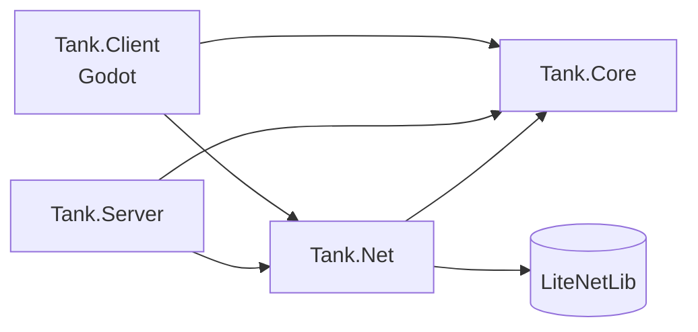

# 04 · 工程结构、测试与开发计划

## 1. 仓库结构

```text
BattleCity/
├── Tank.sln
├── global.json                   # 锁定 .NET SDK 版本
├── Directory.Packages.props      # 统一管理 NuGet 包版本
├── src/
│   ├── Tank.Core/                # 纯玩法仿真，零依赖（不引用 Godot 或网络库）
│   │   ├── Math/                 # 整数向量、AABB、定点数辅助
│   │   ├── World/                # GameState、实体存储（struct 数组）、地图与微砖位图
│   │   ├── Systems/              # Movement、Bullet、Collision、Pickup、Spawn ……按 tick 顺序执行
│   │   ├── Rules/                # 各模式的规则、TankStats 数值表
│   │   ├── AI/                   # 敌人 AI（种子化随机数）
│   │   └── Simulation.cs         # Step(state, inputs) → state，唯一的推进入口
│   ├── Tank.Net/                 # 协议与同步算法（可以引用 LiteNetLib）
│   │   ├── Protocol/             # 消息定义、BitWriter/BitReader、增量编解码
│   │   ├── Transport/            # LiteNetLib 封装、局域网发现
│   │   ├── Client/               # 预测、对账、插值缓冲、时钟同步
│   │   └── Server/               # 输入缓冲、历史环形缓冲、延迟补偿、每个客户端的快照增量
│   ├── Tank.Server/              # 控制台入口：参数解析、tick 循环、房间管理
│   └── Tank.Client/              # Godot 4 工程（project.godot + C#）
│       ├── scenes/               # 主菜单、大厅、对局、HUD
│       ├── scripts/
│       │   ├── Bootstrap/        # 启动、设置、内嵌服务器
│       │   ├── View/             # 状态 → 节点的映射：TankView、BrickMultiMesh、BulletView、Fx
│       │   ├── Input/            # 输入采样与锁存
│       │   └── UI/               # 菜单、房间列表、net_graph
│       └── assets/               # glTF 模型、音频、着色器
├── tests/
│   ├── Tank.Core.Tests/          # 规则与碰撞单测、回放确定性测试
│   ├── Tank.Net.Tests/           # 序列化、增量压缩、预测与对账、插值、延迟补偿
│   └── Tank.Soak/                # 进程内：1 个服务器 + N 个机器人客户端 + 网络环境模拟
├── src/Tank.Core/Maps/           # 关卡文本文件（作为嵌入资源打包，服务器与客户端用同一份）
├── tools/genmaps.py              # 内置地图生成脚本
└── docs/
```

### 依赖方向（严格单向）



- `Tank.Core` **不允许**引用 Godot、LiteNetLib 和 `System.Random`（统一使用自带的 `Xorshift` 随机数），也不允许读取系统时间。这条规则由 CI 中的架构测试强制检查（例如 NetArchTest）。
- `Tank.Client` 只负责「显示」和「采样输入」，**不包含任何玩法判定**。

## 2. 核心数据流

```text
GameState（不可变快照语义）
  Simulation.Step(in GameState prev, ReadOnlySpan<InputCmd> inputs, ref GameState next)
```

- 采用「前一状态 → 下一状态」的双缓冲：服务器保存历史，客户端回滚重放，都只是缓冲区之间的复制，没有共享的可变状态。
- 为了满足零 GC 要求，GameState 内部是预分配的 struct 数组，**逻辑上按值对待**（复制即快照），不在原状态上修改。

## 3. 关键类（示意）

| 类 | 职责 |
|---|---|
| `Simulation` | 按 [03 §6.3](03-netcode.md#63-判定规则在服务器上按-tick-内的固定顺序执行) 的固定顺序调用各个 System，推进一个 tick |
| `ClientPredictor` | 输入环形缓冲、预测、对账重放、误差平滑偏移 |
| `SnapshotInterpolator` | 快照缓冲、自适应 `interpDelay`、插值与外推 |
| `ClockSync` | 根据 `inputSlack` 调节时间流速 |
| `ServerInputBuffer` | 按 tick 索引每个玩家的输入，处理缺失和重复 |
| `LagCompensator` | 历史包围盒环形缓冲，提供弹丸快进时的回溯查询 |
| `SnapshotEncoder` / `SnapshotDecoder` | 基于已确认快照做增量编解码、位打包 |
| `LanDiscovery` | 广播 DISCOVER、收集 ROOM_INFO |
| `MatchRecorder` | 录像（种子 + 地图 + 输入流）与回放 |

## 4. 测试策略

采用 TDD，`Tank.Core` 和 `Tank.Net` 的覆盖率 **≥ 80%**，并作为 CI 门禁。

| 层级 | 内容 | 例子 |
|---|---|---|
| 单元测试 | 规则、碰撞、序列化 | `Bullet_destroys_4x1_brick_strip_on_hit`、`Turning_snaps_to_half_tile_grid`、`Delta_decode_roundtrips_after_dropped_snapshots` |
| 确定性测试 | 同一份录像重放两次，每个 tick 的状态哈希完全相同 | 跑 10 分钟的机器人对局，对比 36000 个哈希 |
| 预测一致性测试 | 无丢包时，客户端预测与服务器状态的误差恒为 0 | 进程内启动服务器和客户端，断言 `mispredictions == 0` |
| 网络环境测试 | `Tank.Soak`：8 个机器人 × {0ms、30ms±20ms、5% 丢包、20% 丢包} | 断言不断线、预测误差率、外推次数、带宽、服务器 tick 的 P99 |
| 端到端冒烟测试 | Godot 无头模式启动客户端，自动开房、连接、打完一关 | 每晚运行 |
| 人工体验测试 | 有线 + Wi-Fi 实机对局；120/144Hz 显示器下观察 | 每个里程碑执行一次，结果记入检查清单 |

## 5. 开发里程碑（1～2 人，约 13 周）

| 里程碑 | 周期 | 交付物 | 验收 |
|---|---|---|---|
| **M0 骨架** | 1 周 | 解决方案与工程结构、CI（构建、测试、覆盖率、架构规则）、Godot 空场景能引用 Core | CI 全部通过 |
| **M1 单机核心** | 3 周 | `Tank.Core`：移动和贴格、子弹、砖墙与钢墙破坏、地形、老鹰、AI、道具；Godot 中能单机玩第 1 关（简易方块美术） | 单机可玩；Core 覆盖率 ≥ 80% |
| **M2 联网基础** | 2 周 | LiteNetLib 接入、局域网发现、大厅、输入上行、完整快照下行、实体插值（先不做预测） | 两台机器能联机，画面平滑但有输入延迟 |
| **M3 CS 级手感** | 3 周 | 客户端预测与对账、误差平滑、开火预测、时钟同步、增量压缩、延迟补偿、`net_graph`、网络环境模拟 | 达到 [03 §11](03-netcode.md#11-网络手感验收标准) 的全部指标 |
| **M4 内容** | 2 周 | 三种模式、15 张以上地图、全部道具、计分与结算、断线重连 | 8 人对战跑满 30 分钟无异常 |
| **M5 打磨** | 2 周 | 体素美术、特效、音效与配乐、镜头切换、设置菜单（按键、画质）、着色器预热 | 主流配置 ≥ 144fps |
| **M6 发布** | 持续 | 三平台导出、防火墙说明、录像上报 | — |

> **M3 是风险最高的阶段**。建议 M2 结束时就在测试中跑通「录像回放 + 确定性哈希」，否则 M3 的预测问题会很难排查。

## 6. 编码约定（摘要）

- `Tank.Core` 中禁止使用 `float` / `double` 参与逻辑计算，只有渲染层可以把整数坐标转成浮点。
- 每帧都会执行的热路径禁止使用 LINQ、`new` 引用类型和闭包；Code Review 时重点检查。
- 文件 200～400 行为宜，最多 800 行；函数不超过 50 行；按功能拆分目录。
- 提交信息遵循 Conventional Commits（`feat:`、`fix:`、`perf:` ……）。

## 7. 风险与对策

| 风险 | 影响 | 对策 |
|---|---|---|
| 版权和商标 | 无法公开发布 | 不使用 Battle City 名称、原版美术、音乐和关卡原图；自制全部素材；玩法规则本身不受版权保护 |
| Wi-Fi 抖动严重 | 远端实体卡顿 | 自适应抖动缓冲 + 外推；在 `net_graph` 中提示「建议使用有线网络」 |
| 预测与服务器不一致 | 频繁拉回 | 整数运算、固定执行顺序、确定性测试、预测误差日志 |
| Godot C# 的 GC 停顿 | 周期性卡顿 | 热路径零分配，CI 中加入分配回归测试（`GC.GetAllocatedBytesForCurrentThread`） |
| 广播被路由器屏蔽 | 找不到房间 | 支持手动输入 IP；显示本机 IP 便于告知他人 |
| 系统防火墙拦截 | 无法连接 | 首次启动时提示；Windows 安装包注册防火墙规则 |
| 房主掉线 | 对局结束 | 本期接受这一限制；需要时可改用专用服务器部署 |
| 后续要支持公网 | 延迟上升 | 现有的预测、插值和延迟补偿天然适用于公网；只需加入 NAT 穿透或中继（LiteNetLib 自带 NAT punch） |
