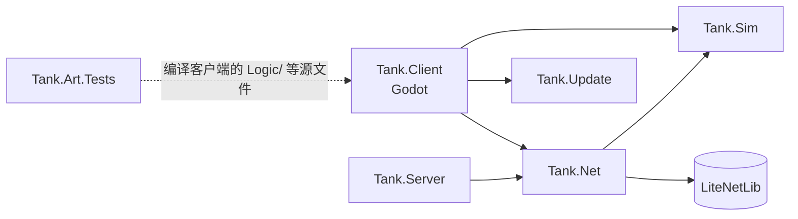

# 04 · 工程结构、测试与开发计划

## 1. 仓库结构

```text
BattleCity/
├── Tank.sln
├── global.json                    # .NET SDK 8.0.425 起（可用更高的 8.0）
├── Directory.Build.props          # net8.0、C# 12
├── Directory.Packages.props       # 统一管理 NuGet 包版本
├── build.json                     # 版本号和一句话说明（发布用）
├── src/
│   ├── Tank.Sim/                  # 玩法仿真：纯 C#，只引用基础库
│   │   ├── Geometry/              # Obb2、OrientedBox、Intersect、Angles、XorShift
│   │   ├── Terrain/               # HeightField（双线性采样、法线、射线求交）、TerrainGenerator
│   │   ├── Maps/                  # Battlefield（地形 + 物件 + 物件状态 + 地面和水）、PropIndex（物件网格索引）、MapData、Prop、WallLine、
│   │   │   │                      #   SurfaceMap、GroundSpeed、MapCatalog / MapDefinition（按名字取地图；NewNavGrid 每局拷一份导航网格）、
│   │   │   │                      #   SandboxMap、RiverlandMap、BotMapData（机器人的车道和掩护位，各地图类的 Bots）
│   │   │   ├── Building/          # 生成工具：ValueNoise、Polyline、DistanceGrid、HeightSculpt、PlacementGrid、PoissonDisc、Passability
│   │   │   └── Riverland/         # 河谷的布局和生成：地形、河湖、公路、地面类型、村镇、岩石、草丛、树
│   │   ├── Vehicles/              # TankSpec、TankCatalog、TankState、TankMotion、TankStep、TankPose、Concealment
│   │   ├── Combat/                # Dispersion、Ballistics、Armor、Penetration、WallDamage、ShotRandom、Shell
│   │   ├── Vision/                # Spotting（一次观察）、VisionTracker（按队汇总、保持 2 秒）、CrateSight（看不看得见补给箱的牌子）
│   │   ├── Modes/                 # BattleMode（五种模式和 ModeRules：每种模式的上限、地图、有没有毒圈和补给箱）、MatchRules（判定、排名、伤害和存活时间、吃箱子、放毒）、
│   │   │                          #   MatchEndReason（为什么结束）、SpawnLayout、TeamBase（标准战的基地）、BaseCapture（占领，按 tick 整数记）、
│   │   │                          #   Zone（ZoneRing、ZoneSchedule 五圈的时间表、ZoneState 纯函数）、ZonePicker（按种子和导航格挑圆心）、
│   │   │                          #   Crates（CrateKind、Crate、CrateTake、CrateRules 五种效果的数、CrateSet 一局的箱子：拾取和视野掩码）、CratePlacer（按种子摆 48 个箱子）
│   │   ├── Navigation/            # NavGrid（4 m 通行网格）、PathFinder（A*、拉直）、PathService（一局的寻路排队和预算）、PathStatus、NavDisc
│   │   ├── Ai/                    # 对局机器人：BotDirector（一局一个：分工、回防、出命令；BotDirector.Zone：吃鸡的圈和跑圈的点；BotDirector.Crates：挑箱子）、Bot（一辆车；
│   │   │                          #   Bot.Zone：跑圈和圈里巡游，Bot.Crowd：吃鸡里的拥挤和卡住、不开下悬崖，Bot.Crates：捡箱子）、TargetPicker（选目标）、
│   │   │                          #   Gunnery（提前量、下坠、俯仰）、BotSeating（开局的坐法和机器人种子）；PatrolDriver（试驾场 AI 靶车）、Steering
│   │   └── Simulation*.cs（含 HurtByZone、TakeCrate）、InputCmd.cs、GameEvent.cs（含 KillCause 击毁原因、CratePicked）、SimConstants.cs
│   ├── Tank.Net/                  # 网络（引用 Tank.Sim 和 LiteNetLib）
│   │   ├── Protocol/              # BitWriter、BitReader、Channel、ProtocolException
│   │   ├── Transport/             # LiteNet 客户端 / 服务器传输、LoopbackNetwork（内存模拟网络）、LanDiscovery
│   │   ├── Timing/                # ServerRunner（服务器线程）、ClockSync（客户端时钟）
│   │   └── Battle/                # 协议 v6（含 ZoneMessage、ZoneSync、CrateMessage）、BattleServer（含按模式的座位、挑圈和公布；BattleServer.Crates：摆箱子、
│   │                              #   每个真人座位的箱子视野、拾取消息）、BattleClient（含圈的列表和 ZoneAt、见过的箱子和拾取队列）、CrateKnowledge（客户端见过的箱子）、
│   │                              #   预测、插值、快照编解码、可见性、ServerMaps（每张图准备一次，含导航网格）
│   ├── Tank.Server/               # 无头专用服务器（Program.cs：参数解析、起服务器线程、等 Ctrl+C；--mode royale 只配河谷，监听行写每局 48 个箱子）
│   ├── Tank.Update/               # 在线升级：清单、签名校验、下载、替换脚本（不依赖 Godot）
│   └── Tank.Client/               # Godot 4 工程（project.godot + C#）
│       ├── scenes/                # Main.tscn（主场景）、Sandbox.tscn（试驾场，可直接启动）
│       ├── scripts/               # 见 §3
│       ├── shaders/               # 卡通着色器：地形（河谷的地面图层在这里）、远景地面、坦克、草、草丛、岩石、墙、树、房子、水面、基地的圈、天空、烟团、
│       │                          #   光墙（zone_wall）、圈外泛蓝（zone_vignette）
│       └── assets/fonts/          # 站酷快乐体和 OFL 许可证
├── tests/
│   ├── Tank.Sim.Tests/            # 仿真规则，含 ArchitectureTests（纯度检查）
│   ├── Tank.Net.Tests/            # 协议、服务器、客户端、预测、插值、发现、完整对局
│   ├── Tank.Art.Tests/            # 客户端里不依赖引擎的代码：网格库、各 Logic/ 目录、启动参数、调色板
│   ├── Tank.Update.Tests/         # 在线升级
│   ├── Shared/                    # Allocation.cs：零分配检查（重建场景最多量 3 次），链接进 Sim、Net、Art 测试
│   └── Tank.Soak/                 # 网络压测：服务器 + 4 客户端 + 4 机器人，四种模拟链路；再一行河谷吃鸡（4 客户端 + 12 机器人）
├── tools/
│   ├── ship.sh                    # 测试、打包、建 GitHub Release、发更新源、改版本号
│   └── ci_release.sh              # 发布工作流的辅助步骤
├── .github/workflows/             # ci.yml（测试、soak、编译）、release.yml（改了 build.json 版本就自动发布）
└── docs/                          # 本目录；PROGRESS.md 是进度，superpowers/ 下是各阶段的设计和计划
```

## 2. 依赖方向



- **`Tank.Sim` 不依赖任何东西**：只引用基础库，不许用系统时间、`Stopwatch` 和 `System.Random`。`tests/Tank.Sim.Tests/ArchitectureTests.cs` 按程序集引用和字段类型检查（直接调用 `DateTime.Now` 查不出来，靠审查）。这样服务器和客户端预测跑的是同一份可重放的代码，测试也都可复现。
- **`Tank.Net` 不依赖 Godot**：`BattleServer`、`BattleClient` 在测试和 soak 里直接用。
- **客户端的 `Logic/` 目录不许 `using Godot`**：所有 `scripts/**/Logic/**` 和网格库 `Art/Mesh/**`，以及几个点名的文件（`Art/Palette.cs`、`Bootstrap/LaunchOptions.cs`、车辆外观数据等），由 `Tank.Art.Tests.csproj` 直接编译进测试项目。里面一旦用了 Godot 就编译不过。
- 客户端只负责显示和采集输入，**不做玩法判定**；试驾场在本地跑 `Simulation`，对局只读 `BattleClient`。

## 3. 客户端主要目录（`src/Tank.Client/scripts`）

| 目录 | 内容 |
|---|---|
| `Bootstrap/` | `Main`：根节点和界面流程（菜单 → 连接中 → 房间 → 对局 → 房间，试驾场作为子节点挂上）；`LaunchOptions`：唯一读启动参数的地方（`HostMap`：开房的地图，吃鸡强制河谷）；`CaptureRun` 和 `Logic/ShotPlan`：脚本化截图（场景的小地图还没有图时，到点的截图等它，最多 20 秒；`outside` 时刻：自己第一次在安全区外；`pickup`：自己第一次吃到补给箱）、帧时间日志、定时退出 |
| `Online/Logic/` | `BattleSession`（一个会话：客户端加可选的房主后端）、`ThreadedHost`（房主服务器线程）、`LoopbackHost`（`--loopback` 的虚拟网络）、`LanBrowser`（房间列表）、`Reconnector`（断线重连）、`SeatTokens`（按规整过的房间地址在内存里记住重连令牌，从菜单再进时带上）、`AutoRoom`（按启动参数自动操作房间）、`TickProbe`（量服务器 tick 耗时） |
| `UI/` | `MenuScreen`（名字、开房间、试驾场、局域网列表、手填地址）、`RoomScreen`（模式、地图、机器人、车型、换队、准备、开局；换不到的模式灰掉、悬停给原因；无队伍模式多于 8 行分两列）、`UiKit`（按钮和文字样式）；`Logic/` 里是房间规则（`RoomRules`：按模式的机器人数和“吃鸡只在河谷开”）、`RoomModel`（`ModeChoice` 模式列表、`MaxBots`、`MapHint`）、名字截断和 `MapText`（地图名、窗口标题）、`ModeText`（模式名和一句话规则） |
| `Match/` | `MatchMain`：对局场景，每帧驱动 `BattleClient` 并画出它知道的一切（吃鸡：每帧按渲染 tick 读 `client.ZoneAt`，给光墙、HUD、小地图和 `zone` 机位；每帧取 `client.TryDequeuePickup` 给飘字、补给箱的闪光、截图时机和一行日志 `[match] picked up …`）；`TankActors`（别人的车）、`MatchInput`、`MatchHud`、比分板、击毁提示、计分板、结算、暂停层、F3 面板、`CaptureBarsView`（标准战比分板下的占领进度条）、`ZoneLineView`（吃鸡比分板下的毒圈行）、`ZoneWarningView`（圈外的泛蓝暗角和“在安全区外”）、`PickupToastView`（横幅下的拾取飘字）、`BuffRowView`（状态面板上方的叠层图标）、`HudGallery`（`--hud-demo`；`minimap`、`map-full` 两屏带河谷的小地图，`royale` 等六屏吃鸡，含补给箱的 `royale-crates`）；`Logic/` 里是布局、文字、阵营色、观战状态、计分板模型、进度条和它的报警（`CaptureBars`）、`ZoneHud` / `ZoneText`（一帧的毒圈数据和它的文字）、`ScoreboardMetrics`（常规和紧凑的行高字号）、`ZoneCamera`（截光墙的 `zone` 机位）、`CrateHud`（`BuffHud` 自己的叠层、`PickupFeed` 最近 3 条飘字、`CrateText` 箱子的文字）、`CrateCamera`（截箱子特写的 `crate` 机位） |
| `Sandbox/` | 试驾场：`SandboxMain`（本地跑 `Simulation`）、`TargetRange`（靶车；`FillMinimap` 把本队看得见的靶车填进小地图）、`RangeDemo`（`--range-demo` 自动打靶）、`SandboxInput`、`SandboxHud`；`Logic/MapSites`（每张图的站点：出生点、靶车、有没有巡逻车、机位锚点和可用的机位、演示，对局的固定机位也从这里取）、`Logic/RiverlandDemos`（河谷的演示） |
| `World/` | `BattleWorld`：天空、地形网格（建地形用的地面遮罩留在 `GroundMask`，小地图烘底图用同一张）（32 × 32 格一块，河谷用层叠的地面图层）、`WaterSurface`（水面，只建在有水的格子上）、岩石、草丛、墙和栅栏、`ForestViews`（林中的树，按扇区的 `MultiMesh`，倒下动画）、`HouseViews`（房子、倒塌、废墟）、`BaseRings`（标准战地上的两个基地圈，带宽和实线在 `Logic/RingBand`）、`ZoneWall`（吃鸡当前圈的光墙：网格、材质和 256 × 1 的墙脚高度纹理；常数和采样在 `Logic/ZoneWallShape`）、`CrateViews`（吃鸡里客户端知道、还在的补给箱：木箱和浮动的牌子，`Version` 变了才重扫；被看着吃掉时闪光，闪不闪在 `Logic/CrateFlash`）、地面小草、外围树林；物件状态变了才全量同步瓦砾、倒下的栅栏和没了的草丛；树和房子挡住自己的车时变半透明（`Logic/SeeThroughFades`） |
| `Minimap/` | 小地图（规则见 [01 §9.1](01-game-design.md#91-小地图)）：`MinimapLayer`（一个场景一个，和 HUD 同在第 2 层、加在它后面；右下角的小图和全屏组（压暗、地图名、“M / Esc 关闭”），位置取 `HudLayout` 的 `Minimap`、`FullMap`；`Build` 把底图交给工作线程烘，`Show` 每帧取烘好的底图、局部重画、按需上传纹理；`HasPicture` 给脚本截图等图）、`MinimapView`（一张图：圆角底框、带 mipmap 的底图、按顺序画图标，`_Draw` 不分配）；`Logic/` 里是引擎无关的部分：`MinimapArea`（图上的正方形和地面坐标的换算）、`MinimapGround`（烘底图：地面类型、草、岩石、水深、树冠密度加闭运算、西北光的明暗；只读一局里不变的数据）、`MinimapImage`（底图加房子和墙，按 32 像素的块局部重画）、`MinimapStyle`（底图的系数和派生色、两套图标大小 `MinimapIconSizes`、图标颜色）、`MinimapFrame`（一帧的图标：车、基地、视点 `MinimapEye`、自己的残骸、吃鸡的圈 `MinimapZone`、补给箱 `MinimapCrate`，数组预分配）、`MinimapFeed`（从对局数据填图标：只用快照里的车和基地分数；`AddZone` 填当前圈和下一圈，`AddCrates` 填见过、还在的箱子）、`MinimapEyes`（视点放在哪；镜头的地面朝向和水平半视角）、`MinimapGlyphs`（箭头、四种形状、叉、扇形、进度弧的几何，写进调用方的缓冲） |
| `Vehicles/` | `TankModel`（程序化的玩具坦克）、`TankActor`（模型 + 残骸黑烟 + 扬尘）、外观数据、履带滚动和车体点头、炮管后坐、击毁时飞起的炮塔 |
| `Combat/` | 炮口火光和爆炸、曳光（这两样池化，不在每发炮弹时分配）、补给箱的拾取闪光（`BattleFx.Pickup`，4 个专用槽）、物件被毁的碎块、扬尘、残骸黑烟；涉水的水花和落水的水柱（`Logic/SplashRules`，特效自己找 `WaterSurface` 查水深） |
| `Overlay/` | `CombatHud`（试驾场和对局共用）：准星、状态面板（含地面提示 `Logic/GroundText`）、命中大字和伤害数字、血条和名字、狙击镜暗角、点亮调试文字 |
| `Driving/` | `DriveInput`（驾驶和开火键，运行时注册）、`AimSolver` + `Logic/AimMath`（屏幕中心 → 瞄准角）、`Logic/FireLatch`（开火锁存） |
| `Cameras/` | `OrbitCamera`（第三人称和狙击镜；`GroundHeading`、`HalfFov`：镜头在地面上的朝向和水平半视角，给小地图的扇形）、`CameraPresets`（截图和测帧用的固定机位；吃鸡对局另认 `zone`、`crate`） |
| `Art/` | `Palette`（全部颜色，含光墙的 `ZoneWall`、五种补给箱的颜色 `Crate(kind)`）、`Materials`（加载着色器）、`Mesh/`（网格库：挤出、旋转体、圆角板、岩石、草丛、树、墙、房子、水面、贴地的圆环带 `RingMesh`、光墙的单位圆柱面 `ZoneWallMesh`、补给箱 `CrateMesh`（木箱、杆、五种牌子和图标）、地面图层贴图、扇区网格等） |
| `Update/` | `UpdateService`：把 `Tank.Update` 接到引擎上，只在正式包里启用 |

## 4. 核心数据流

**服务器每 tick**（30 Hz，见 [03 §3.1](03-netcode.md#31-服务器的一个-tick)）：收包 → 机器人 `BotDirector.Update` → 每辆车的输入（真人的输入缓冲 / 机器人的 `BotDirector.Command`）→ `Simulation.Step` → `VisionTracker.Update` →（吃鸡，点亮算的那一 tick）每个真人座位看得见的补给箱 → `MatchRules.Update` → 吃鸡里这一 tick 开始等待的圈发可靠的 `ZoneMessage`、真人吃到的箱子给本人发可靠的 `CrateMessage` → 每个客户端：过滤事件、建快照、发送。

**`MatchRules.Update` 的顺序**（吃鸡、有箱子和圈时；其他模式没有第 1、2 步）：1. 吃箱子：`Crates?.Collect(sim)`，按槽位（车号）顺序，活车车身的 OBB 碰到还在的箱子就 `Simulation.TakeCrate`（改车的血、弹或叠层，发 `CratePicked` 事件），这一 tick 吃掉的记在 `CrateSet.Pickups` 里给服务器发消息；2. 放毒：`elapsed = Sim.Tick − StartTick`，`Zone = ZoneState.At(ZoneRings, elapsed)`；对上次 `Update` 以来跨过的每个开局后的整秒 s（正常每 tick 至多一个，跳过了 `Update` 时补上），取那一秒的圈，圈外每秒掉血大于 0 时给每辆活着、在圈外的车 `Simulation.HurtByZone(id, ZoneSchedule.DamageOf(最大血量, 百分比))`（不走装甲和保护期；归零时发 `TankDestroyed`，`Cause = Zone`、`TankId = 0`）；3. 读这一 tick 的事件（含第 2 步的毒圈击毁）：击毁照旧（毒圈击毁不算任何人的击杀）、伤害（每发最多记到目标上一次 `Update` 结束时剩下的血，不算自己和同队）；4. 占领、复活、判定；5. 记下每个座位的车现在的血量（下一 tick 算伤害上限用，也是同 tick 阵亡时排名用的“阵亡前的血量”）。开局时服务器先用 `ZonePicker.Pick`（对局种子 ^ `ZonePicker.SeedSalt`，地图准备时建好的导航网格的一份拷贝）挑好六个圈（第 0 圈加五圈），再用 `CratePlacer.Place`（对局种子 ^ `CratePlacer.SeedSalt`，同一份网格）摆箱子（先建一个 `CrateSet` 检查，并查每个箱子的坐标在快照的厘米范围内），然后建 `MatchRules`（它用 `ZoneSchedule.Check` 查圈套圈，带上箱子建这一局的 `CrateSet`）；圈、箱子、规则或机器人起不来时房间不变。

**机器人**（`Ai/`、`Navigation/`，规则见 [01 §2.3](01-game-design.md#23-机器人)）：服务器开局时用 `BotSeating` 坐好机器人（抽车型、进人少的队、各自的种子），建这一局的 `BotDirector`（拷一份地图准备时建好的 `NavGrid`）、加机器人、分工，整局都建好了才交给服务器。`BotDirector.Update` 每 tick 一次：上一步的事件里倒下的物件进网格（`PathService.Refresh`；漏了 tick 时 `Sync` 整体补算），命中进各机器人的 `TargetPicker`，复活的重新开始这一段；标准战里查回防、解除和全队压上；吃鸡里取规则的 `Zone`；`PathService.Observe` 记下残骸和站着不动的车；`PathService.Run` 用这一 tick 的 3000 次扩展。然后每个机器人的 `Command`：取回寻路结果、（吃鸡）跑圈和要不要先跑、每 6 个 tick 看要不要去捡箱子（`BotDirector.CrateFor`）、后撤、选目标、开车或交战，给出一条 `InputCmd`。这两步开局后不分配；只用种子随机数和仿真状态，按车号排队。

**`Simulation.Step` 内部**：先报上一步之后挂起的事件（复活）；记下所有车的占地；每辆活着的车按槽位顺序 `TankStep.Advance`（清洗输入、车体转向、行驶和撞物件、瞄准、散布、装填、开炮），碰撞对照的是这一 tick 开头别的车的位置，所以结果不依赖槽位；最后是炮弹阶段：炮管顶在障碍物里的炮弹就地爆炸，其余每发飞一步、结算命中。

**客户端每帧**（`MatchMain._Process`）：

```text
session.Advance(dt)                                 // 回环主机在这里推进虚拟网络和服务器
cmd = 输入（油门、转向、瞄准角、开火、弹种）；阵亡、暂停、结算时只留瞄准
client.Update(dt, cmd)                              // 预测、对账、插值、事件、炮弹，见 03 §3.2
事件 → 特效和 HUD（开炮、爆炸、命中字、击毁、物件被毁）
自己的车：Predictor 的上一 tick / 这一 tick 按 Clock.Alpha 插值 + 平滑偏移
别人的车：client.Others（插值后）；炮弹：client.Shells
吃鸡：zone = client.ZoneAt(插值的渲染 tick) → 光墙 Show(zone.Current)，自己的活车在不在圈外
吃鸡：client.TryDequeuePickup → 飘字、截图时机；CrateViews.Sync(client.Crates)（新见到的立起来，没了的删掉，看着被吃的闪光；牌子浮动）
镜头 → 瞄准角（AimSolver）→ 世界、车、炮弹、HUD 刷新（毒圈行、圈外提示、飘字、叠层图标）→ 小地图（填图标、圈和箱子、Show）→ 截图自动化（到点的截图等小地图的图）
```

**协议 v5**（6A；`BattleProtocol.Version = 5`，消息表和格式见 [03 §4](03-netcode.md#4-协议)）：座位上限 `BattleProtocol.MaxPlayers = ModeRules.MaxPlayers`（16），每种模式的上限 `ModeRules.MaxPlayersFor`（吃鸡 16，其他 10），局域网答复里的上限按房间当前的模式填。新消息 `Zone = 26`（`ZoneMessage`：对局号 VarUInt、第几圈一个字节（1～5）、圆心 x、z 和半径三个 float，半径 ≥ 0、坐标在 ±100 km 内；可靠通道，圈的等待段开始时发）。开局消息（`MatchStartMessage`）的尾部在基地之后加一个字节圈数（0 = 没有毒圈；否则 2～6）、开局的 tick（VarUInt）和各圈（三个 float）：第 0 圈和已经公布的圈，重同步也带。事件（`GameEvent`）在 `PropId` 之后多 2 位击毁原因（`KillCause`：`Shell = 0`、`Zone = 1`，别的值拒收）。快照的对局块（`MatchBlock`）在结束原因之后加一个字节参赛人数 `Entrants`（吃鸡里 `MatchRules.Entrants`，其他模式 0，读时 > 16 拒收）；计分板每行（`PlayerStats`）的名次从 4 位改成 5 位（0 = 没有名次，1～16；17～31 拒收），`Capture` 之后加 `Damage`、`Lasted`（VarUInt，秒）。客户端（`BattleClient.Match.cs`）存固定的 6 个圈：开局消息带圈且模式有毒圈时整个替换，`ZoneMessage` 只在对局号是当前的、第几圈正好是下一个时追加（重复的不变，隔着没收到的丢掉，重同步补齐），离开对局清空；`ZoneAt(渲染 tick)` 只用来画和写字，伤害只在服务器算。

**协议 v6**（6B；`BattleProtocol.Version = 6`，格式见 [03 §4](03-netcode.md#4-协议)、[03 §5.1](03-netcode.md#51-补给箱)）：新消息 `Crate = 27`（`CrateMessage`：对局号、箱子编号、种类、位置、两个数、层数；只发给吃到的人，可靠通道）。快照（`BattleSnapshot.CrateCount`、`Crates`，每行一个 `CrateView`：编号、种类、在不在、x、z 厘米）在自己的车之后、计分块之前加箱子块：这个座位上次点亮时看得见的箱子；`OwnTank` 末尾三种叠层各 2 位。开局消息（`MatchStartMessage.Crates`）在圈之后加一个字节个数和这个座位见过、没看见已空的箱子（视野外被吃的照旧带，[03 §5.1](03-netcode.md#51-补给箱)）。`GameEventType` 追加 `CratePicked = 8`，服务器从不发它（`Viewer.Wants`）。服务器（`BattleServer.Crates.cs`）每个座位三个 `ulong` 掩码：上次看见的（快照的行）、这一局见过的、看见已空的（快照里 `Standing` 为假的行和自己吃的）；重同步发见过 ∧ ¬看见已空。客户端（`BattleClient.Match.cs`）的 `Crates`（`CrateKnowledge`）开局时按开局消息重置、每份最新快照 `Apply`、收到 `Crate` 消息 `Take`，离开对局清空；`TryDequeuePickup` 是自己的拾取（队列预开 64，满了丢最旧，新开局清空）；`OwnState` 把叠层写进预测用的车，装填的预测和服务器一致。

**小地图**（`Minimap/`）：场景建好时 `MinimapLayer.Build` 把底图交给工作线程（`Task.Run` 里的 `MinimapGround.Bake`，1024 × 1024；只读地形、地面类型、水和树的位置，这些一局里不变，所以场景照常往下跑；出错由工作线程记日志），烘好记一行 `[minimap] baked 1024 px in … ms`，5 秒还没好记一行 `still baking`。画廊里同步烘。每帧 HUD 刷新之后：

- 填图标：`MinimapFrame.Clear`，`MinimapFeed.AddBases`（对局块里两个基地的分数），`MinimapEyes.Pick`（视点和自己的残骸，镜头朝向和半视角取自 `OrbitCamera`），`MinimapFeed.AddOthers`（`client.Others`，跳过视点所在的那辆），`MinimapFeed.AddZone`（这一帧的 `ZoneState`：当前圈和公布了的下一圈，闭合后没有下一圈），`MinimapFeed.AddCrates`（`client.Crates` 里已知、还在的箱子，按编号）；试驾场是自己的箭头（车被打掉时是圈和残骸叉）加 `TargetRange.FillMinimap`。图标每帧重填，不分配。小地图只读快照（箱子只读客户端见过的），所以服务器的可见性裁剪（[03 §5](03-netcode.md#5-可见性裁剪)）就是它的全部过滤；
- `MinimapLayer.Show(frame, field)`：底图烘好后的第一次在场景线程上画上房子和墙（`MinimapImage`），上传纹理（带 mipmap，小图上 1024 像素缩到 232 不闪），下一帧起 `HasPicture` 为真；之后 `MinimapImage.Refresh` 先比 `Battlefield.StateVersion`，没变就什么也不做，变了只比每个房子和墙的站立状态，把变了的那几个碰到的 32 像素块从底图拷回、再把登记在块里的房子和墙按现在的样子画上，结果和整张重画逐字节相同、不分配（推倒一座房子重画 1 块，约 0.35 ms）。纹理最多每 0.2 秒上传一次：0.2 秒内连着倒的几样合在一次上传里，停下后最后那次也会传上去；局部重画后的每次上传记一行 `[minimap] repainted N tiles`（整张上传不记）；
- 重同步换来的同一张图的新场地（`Fresh()` 的副本，共用物件表）照常局部重画；同一地形、物件表不同的场地在同一张底图上整张重画一次；地形不同的报错一次、留着旧图。

三个时间域不要混：自己的车在“现在”（领先服务器），别人的车在“过去”（约 100 ms），炮弹在客户端 tick 上步进。

**试驾场**：`SandboxMain` 自己攒时间，按 30 Hz 步进本地的 `Simulation` 和 `VisionTracker`，晚一个 tick 插值显示；没有网络。

## 5. 测试

全部测试不需要 Godot，`dotnet test` 就能跑。CI（`.github/workflows/ci.yml`）推到 main 和每个 PR 都跑四个测试项目（收集覆盖率，没有门禁）、soak，再编译专用服务器和客户端程序集。

| 项目 | 内容 | 例子 |
|---|---|---|
| `Tank.Sim.Tests` | 仿真的每条规则：地形采样和求交、平地和坡上的运动、爬坡上限、碰撞、弹道、装甲盒求交、击穿和跳弹的边界、高爆弹衰减、散布、墙和草丛被毁、撞墙、点亮公式和视线、四种模式的规则和结束原因、出生点和路点、架构纯度；导航（网格的代价和关格、物件倒下只重算周围且只会变通变便宜、和重建相同；A\* 和 Dijkstra 代价一致、分次搜索结果相同、网格变化时接着搜、拉直后离障碍 ≥ 2.5 m 且不超过原路 5%、绕开残骸和停着的车；排队按车号、每 tick 预算；两张图的车道和掩护位、所有要去的点连通）；机器人（提前量和下坠、炮打不着时瞄炮塔、选目标的顺序和保持、视线和残骸、只打本队看得见的、400 m；沿路开、每 5 秒重算、卡住倒车、放弃一段；分工、回防和解除、占领点、后撤、全队压上；穿甲打光打高爆、太近时倒退；让开队友；坐法；整局（两张图上十个机器人，河谷上九个机器人加一个不动的真人；坐法和服务器相同）：10 分钟内结束、没有机器人原地卡住 10 秒、每张图至少一局有基地得过分、河谷上两队的进攻车都进过对方基地圈、河谷的固定种子里有一局以占领结束，逐位重放，每 tick 零分配）；标准战（两张图的基地：半径、离本队出生区 40～80 m、平地干地、空旷、两队开得到、间距；占领：每秒 1 分、3 辆上限按车号、挨打和阵亡清零、守军暂停、离圈保留、满 100 不早一 tick、同 tick 双胜平局；两张真图上全歼、占领、10 分钟超时三种结束，十个机器人每 tick 零分配）；物件网格索引（随机查询和全表扫描相同；试驾场地图、密集场地、合成树林、林中房子上开关索引逐 tick 相同；河谷上的查询不超出缓冲的一半）；地面和水的速度系数；树和房子（撞倒、撞塌、打塌发数、遮挡、废墟、恢复）；试驾场地图的指纹不变；河谷的生成（确定、水、公路、房子、树、岩石、草丛、出生点和路点的间距与连通、靶车的意图、Release 下的耗时上限）；吃鸡（第五种模式的数值、16 个座位、只在河谷、16 辆车各自落在 16 个出生点上、出生顺序随种子而各自为战不变、最后一辆赢和按阵亡先后排名、同 tick 阵亡按阵亡前血量再按击毁再按座位、到点按血量、参赛人数；时间表和各圈的公布、缩完、540 s 闭合，掉血向上取整，第 0 圈是外接圆，圈套圈的检查和 1 cm 的余量；圈的状态：等待、收缩的线性插值、闭合、客户端少知道几圈时的表现、小数 tick、各段边界连续、零分配；挑圆心：河谷 200 个种子都套圈、干地、按表的半径，64 次不中落到最近的陆地格，陆地不含湖和关着的格、连不到出生点的格不算，同种子同结果，不改场地和网格，试驾场地图也套圈；圈外掉血：不走保护期、击毁不算谁的、第 0 圈不掉、每整秒掉、开出圈下一整秒起掉、闭合后 10 秒打完满血、非吃鸡忽略圈、坏圈拒收、跳过的整秒补上、开始缩的那一 tick 按收缩段的百分比、炮弹和毒圈同 tick 各记各的；伤害和存活时间：每发最多记到剩下的血、同 tick 两发合计不超、打队友和自己不记、毒圈不算谁的、参赛人数算离开的且同一座位只算一次；机器人跑圈：该不该先跑、出圈就跑、几辆车的点散开、在圈里只巡游圈里、圈外边开边打、有余量就停车打、最后一圈守圈心、点都试完再试、到达半径、急了就急到底、零分配；吃鸡里的拥挤：绕开所有车、守着和等路的车让路、关着的格上找开阔地、崖脚从同一高度搜、巡游不出圈、连续出圈倒车、卡住反着转、不开下悬崖；陡坡（崖脚、崖沿、沿崖脚、坡上的岩石、南坡道的夹角、两张图上没有陷阱和兜、矮崖爬不上去、卡死的车按着转向能直开）；16 辆车的点亮开销；整局（河谷 1 名不动真人 + 15 个机器人，带炮的、血量 ×50 的、不带炮的各几个种子：限时内分出胜负、没有机器人长时间卡住、各圈缩完时圈外的车、多数局第 1 名活到最后、机器人吃到的箱子数、放弃后又跑去同一个箱子的次数、不带炮的局里有车叠满 3 层、逐位重放、每 tick 零分配）；补给箱（五种效果的数和向上取整、装甲层乘在直击和溅射上而毒圈不乘、装填层在开炮和换弹种后生效、光学层加长点亮和看箱子的距离、满了照吃、残骸不吃、复活和换车清掉叠层而原地复活保留；拾取：车身碰到圆就吃、同 tick 车号小的吃到、保护期照吃、维修先于同一秒的毒圈、只有吃鸡有箱子、炮弹和车穿过箱子、零分配；摆放：河谷种子 1～50 各 48 个、房子旁 / 路边 / 林边、空地的各条规则、份额 12 / 10 / 10 / 10 / 6、同种子同结果、不改场地和网格、耗时；视线：牌子顶 1.8 m、地面岩石墙房子挡而栅栏草丛树不挡、墙倒了就看得见、吃掉的也在掩码里、16 辆车 × 48 个箱子一遍的耗时、零分配；机器人捡箱：维修 / 弹药 / 叠层的优先级、150 m、满层不去、时间不够或在要去的圈外不去、有目标时不开始、路上停下打完接着去、别人先吃了就放弃、超时和被岩石围死的放弃后不马上再挑、过了 40 s 或换圈后再挑、零分配） | `PenetrationTests`、`SpottingTests`、`MatchRulesTests`、`NavGridTests`、`PathFinderTests`、`PathServiceTests`、`NavObstacleTests`、`MapBotDataTests`、`GunneryTests`、`TargetPickerTests`、`BotDriveTests`、`BotFireTests`、`BotObstacleTests`、`BotRoleTests`、`BotMateTests`、`BotSeatingTests`、`BotMatchTests`、`PropIndexEquivalenceTests`、`GroundDrivingTests`、`TreeTests`、`HouseRamTests`、`SandboxFingerprintTests`、`RiverlandTerrainTests`、`RiverlandSpawnTests`、`RiverlandPerformanceTests`、`MapBaseTests`、`BaseCaptureTests`、`StandardRulesTests`、`StandardMatchTests`、`RoyaleRulesTests`、`ZoneScheduleTests`、`ZoneStateTests`、`ZonePickerTests`、`ZoneDamageTests`、`MatchStatsTests`、`BotZoneTests`、`BotCrowdTests`、`SteepGroundEscapeTests`、`VisionLoadTests`、`RoyaleMatchTests`、`CrateRulesTests`、`CrateEffectsTests`、`CratePickupTests`、`CratePlacerTests`、`CrateSightTests`、`CrateSetVisibilityTests`、`BotCrateTests` |
| `Tank.Net.Tests` | 位流；输入、快照（完整和增量）、事件、地图、房间消息的编码往返和截断乱包；v3 地图（地面、水、新物件）和各项上限；可见性裁剪（字节流里搜不到看不见的敌人）；预测和对账（完美网络零修正、坏网络下有上限并收敛）；插值；时钟同步；发现；回环网络下四种模式各打完一局；河谷和一张混合小地图上的对局（开局消息 < 1 MiB、开过水沙路和撞倒树零修正、撞树撞房后服务器和客户端的物件状态一致），真 UDP 上的河谷开局；选地图（只有房主、对局中不能设、生成中和失败时不能开局）、地图只准备和编码一次、重同步不重发地图；不可靠包上限；断线重连、中途加入、版本不符、房间已满；服务器每 tick 零分配；协议 v4（基地分数、结束原因、占领、开局消息的基地的往返，越界和截断报错，满员标准战快照小于不可靠包上限，别的版本的房间带不认识的模式照样列出）；标准战服务器（开局要基地、看不见进攻车也收到基地分数、敌方占领分结束后才发、中途加入、一人一局一辆车、宽限内回来拿回原车、只剩等着的人时结束、河谷带机器人打完）；服务器上的机器人（开局分工和 `bots:` 日志、沿车道走、没有机器人数据的地图照样进攻、结束摘要每局只记一次、机器人起不来时房间不变、中途进出、每局按房间的机器人数、同一种子重放、服务器和测试的整局 30 秒逐位相同；9 个机器人时服务器每 tick p99 < 2 ms，量到对局结束）；按模式的座位（10 人模式第 11 个真人被拒、吃鸡 16 个第 17 个被拒、对局中机器人占座、机器人最多 9 个、换到 10 人模式压到 9）；协议 v5（16 个座位和 `Zone` 消息；名次、伤害、存活时间、参赛人数的往返和越界、截断；满员吃鸡快照小于不可靠包上限；每个事件带击毁原因、未知原因拒收；圈的公布消息和开局消息的圈的往返、坏圈一个字节都不写、截断拒收；16 人的房间列出、17 拒收）；吃鸡服务器（换到吃鸡就换到河谷并锁住、11 个真人换不到 10 人模式、没有河谷换不成、选项里吃鸡配别的图报错、局域网答复按模式的上限、开局 16 辆车在 16 个出生点上且已知第 0、1 圈、圈随种子而团队战没有圈、圈起不来房间不变、每圈等待开始时发出且重连拿到已知的圈、对手的伤害和活人的存活时间结束前藏起来、存活时间在出局那一 tick 出现、毒圈击毁人人收到且没有击杀者、团队战座位进出不卡别人也不发参赛人数、等复活的车不发存活时间、出局的人看全场）；客户端的圈（开局带圈、之后一个个追加、重同步替换、新对局没有圈就清掉、离开忘掉、对不上的公布丢掉不算坏包、开局前和离开后的公布忽略、没有毒圈的模式带圈不认、坏公布丢掉计数且对局照常、`ZoneAt` 零分配）；15 个机器人的吃鸡服务器每 tick p99 < 2 ms；协议 v6（版本 6 和 `Crate` 消息；箱子块和叠层的往返、和基线相同时一位、坏块和截断拒收、读不进的块一个字节都不写、叠层超过 3 写成 3；满员吃鸡加 12 个箱子 933 字节小于不可靠包上限、48 个全可见走可靠通道；拾取消息和开局消息里箱子的往返、坏的拒收、截断拒收）；吃鸡服务器的箱子（按种子摆并记日志、摆不成时房间不变、每个座位只知道自己见过的、开过去吃到只告诉吃到的人、别人吃的不广播而且只给看得见那个位置的座位变成已空、重同步带见过而没看见已空的（视野外被吃的照旧带、看着被吃的和自己吃的不带）、座位释放后忘掉、阵亡后不再看见新的、团队战没有箱子也不摆、探针：每份快照的箱子行就是服务器那一 tick 的掩码并独立重算、线上没有 `CratePicked`、每 tick 零分配）；客户端的箱子（`CrateKnowledge`：行变成已知、看不见时保持原样、看见空位才算没了、拾取消息、开局重置、版本只在画的东西变了时动、零分配；拾取消息不是本局、模式没箱子、开局前、离开后都忽略不算坏包，坏的计数而对局照常，新对局和离开清空）；谁都不要 `CratePicked` 事件 | `BattleIntegrationTests`、`BattleServerTests`、`ClockSync30Tests`、`MapWireV3Tests`、`RiverlandMatchTests`、`RoomMapTests`、`ServerMapTests`、`UnreliableLimitTests`、`StandardWireTests`、`StandardServerTests`、`BotServerTests`、`BotLoadTests`、`ModeSeatTests`、`RoyaleWireTests`、`RoyaleServerTests`、`ZoneClientTests`、`CrateWireTests`、`CrateServerTests`、`CrateKnowledgeTests`、`CrateClientTests`、`ViewerTests` |
| `Tank.Art.Tests` | 网格库的各种形状、调色板和着色器默认值一致、车辆外观数据、HUD 布局（1600×900、1600×1200、2100×900）、启动参数解析、房间规则、观战状态、重连逻辑、房主线程；`--map` 和每张图的站点（机位锚点在图内）、地面图层贴图和着色器一致、水面网格在岸线处水深为 0、倒树姿态、房子填满长方体、地面提示文字、水花规则、河谷演示在无画面的仿真里的结果、房间里的地图选择；标准战的文字（比分板、七种结算原因）、占领进度条和报警、计分板的占领格、基地圈的网格和带宽、圈和进度条按两队的颜色、重连令牌的地址规整；小地图（显示的正方形和坐标换算、图像第 0 行是 z 最小的一行；底图的颜色：平地的草和土、公路、岸线、水深、陡坡岩石、西北光、树林只在树冠附近变深而孤树不变大、河谷的林子里读作树林、同一场地烘出同样的字节；房子和墙：站着的颜色和描边、倒了是瓦砾、斜墙至少 2 像素宽且连成一条、推倒和随机倒下立起后局部重画和整张重画逐字节相同（跨块的墙、墙压房子）、没变化不重画、不分配、别的图和别的物件表报错；图标只来自快照（离开快照的下一帧不留痕、各自为战里同队号也是敌人、残骸、跟随的车留给箭头、超出上限丢掉并在 Debug 断言、最多两个基地和各自的分数、填一帧不分配；回环对局里每帧图上的敌人就是快照里的敌人）；四种形状、箭头、叉、扇形、进度弧的几何和图标的大小颜色；视点的选法、镜头的地面朝向和半视角；画廊的两屏地图、点都在可开的地上；小图贴着右下角不压别的块、全屏图居中并留出提示条；`--full-map`；截图等底图、超时照拍、`--quit-after` 跟着等）；吃鸡（房间：吃鸡房 15 个机器人且只在河谷、客人也看到地图提示、团队房不变、无队伍多于 8 行分两列而 8 行以内一列、换不到的模式给原因、机器人不算人数而掉线的座位算、当前模式从不灰掉；`--mode royale`、`HostMap`、`--shot-after outside`；毒圈行和圈外提示的文字（第几圈和倒计时、闭合、向上取整、U+2212 减号）；结算“吃鸡！”“第 N 名”“共 N 名”；击杀栏“死于毒圈”；伤害格和存活格；`ZoneLine`、`ZoneWarning` 的位置；计分板常规和紧凑尺寸、16 行放进框、结算表在页脚之上；小地图的圈（当前圈和下一圈、闭合后没有下一圈、没有毒圈不画）；`Palette.ZoneWall`；画廊五屏；`zone` 机位（25 m 内侧、5 m 高、看 8 m 高的墙、闭合后从 40 m 俯视）；光墙网格（段数 + 1 列、两行、从 +X 转向 +Z、首尾重合不接缝、法线朝外）和墙脚采样（常数、落在圆上、零分配））；补给箱（网格：箱子和仿真一样大、站在地上、板条、杆伸进牌子、牌子中心高度和静止时牌子顶 1.8 m、五种牌子和两面图标分得开、开口环；五种颜色两两分得开；飘字文字和“已满”、最多 3 条、2.5 秒、`×2`、自己的三种叠层、零分配；`Pickup`、`Buffs` 两个框的位置；闪光只在看着被吃掉或自己吃的时候放；`crate` 机位：最近的已知、还在的箱子，3.6 m 外、1.9 m 高；小地图的箱子方块和大小；`--shot-after pickup`；画廊 `royale-crates`） | `HudLayoutTests`、`LaunchOptionsTests`、`ReconnectorTests`、`MapSitesTests`、`GroundLayersTests`、`WaterMeshTests`、`HouseShapesTests`、`RiverlandDemoTests`、`StandardHudTextTests`、`CaptureBarsTests`、`RingMeshTests`、`RingBandTests`、`SeatTokensTests`、`MinimapAreaTests`、`MinimapGroundTests`、`MinimapImageTests`、`MinimapFeedTests`、`MinimapGlyphsTests`、`MinimapEyesTests`、`HudDemoFramesTests`、`ShotPlanTests`、`RoomRoyaleModelTests`、`ZoneTextTests`、`ZoneCameraTests`、`ZoneWallMeshTests`、`ZoneWallShapeTests`、`ScoreboardMetricsTests`、`CrateMeshTests`、`CrateHudTests`、`CrateFlashTests`、`CrateCameraTests` |
| `Tank.Update.Tests` | 版本比较、清单解析和签名校验、解包（含防路径穿越）、找安装目录、替换和失败回退 | `UpdaterTests`、`ManifestAndSignatureTests` |
| `Tank.Soak` | 4 个脚本客户端 + 4 个机器人，试驾场地图上的团队对战，四种模拟链路各 60 秒；再一行河谷上的吃鸡（4 个客户端 + 12 个机器人，16 辆车，Wi-Fi 链路 60 秒：第 1 圈还在等待，只有 16 辆车的流量）；超标就非零退出 | 验收表见 [03 §11](03-netcode.md#11-网络手感验收标准) |

计墙钟时间的测试放在不并行的 `Timing` 集合里（Sim 和 Net 各一个），等并行的测试跑完再跑。零分配测试共用 `tests/Shared/Allocation.cs`：偶尔有一个测量窗口里量到几 KB 不是被测代码分配的运行时噪声，所以每次重建整个场景、最多量 3 次，有一次为 0 就算过；真的每 tick 分配三次都会失败。2026-11-03（6B）的测试数：Sim 1398、Net 464、Art 1478、Update 42。

**Godot 截图自动化**：画面相关的改动靠启动参数跑出截图人工比对（参数全表在 `Bootstrap/LaunchOptions.cs` 文件头）：

- `--screenshot FILE --screenshot-at S`：S 秒后截一张；`--shot-after fire|hit|kill|prop|down|death|ended|outside|pickup:S`：某件事第一次发生后 S 秒截（`outside`：自己的车第一次在安全区外，`pickup`：自己第一次吃到补给箱，都仅吃鸡对局）；`--quit-after S` 定时退出。对局和试驾场里，到点时小地图还没有图（`MinimapLayer.HasPicture`），截图就等（对局场景还没建好时不等），最多等到点后 20 秒（`ShotPlan.MapWaitSeconds`），超时照拍并报错 `[minimap] screenshot taken before the map was baked`；`--quit-after` 跟着等（`Main` 按进程时钟的退出也等）；
- `--loopback --seed N --autodrive`：房主用虚拟网络和固定步长，自动开车开炮，同一个命令每次打出同一局；
- `--hud-demo NAME`：HUD 画廊，用预制数据在纯色底上画 HUD 的各种状态（`timer`、`feed`、`respawn`、`spectate`、`scoreboard`、`results-win` 等；标准战是 `standard`：进行中的比分板、两条进度条和计分板，`capture`：占领获胜的结算；`minimap`、`map-full`：标准战那一屏加上河谷的小图 / 全屏图，四种形状、残骸叉、两个基地的圈和进度弧、箭头和扇形，底图在 `_Ready` 里同步烘；吃鸡是 `royale`：16 人、毒圈行、击杀栏里一条“死于毒圈”、小地图上的当前圈和下一圈，`royale-outside`：第 3 圈收缩、自己在圈外的泛蓝和提示，`royale-map`：`royale` 的全屏图，`results-royale-win`、`results-royale`：“吃鸡！”和“第 7 名”的结算，16 行紧凑计分板，`royale-crates`：三行拾取飘字、两种叠层图标、小地图上 6 个箱子方块）；`--full-map`：进场后打开全屏地图（对局和试驾场）；
- 试驾场：`--sandbox`、`--map sandbox|riverland`（用哪张图，默认试驾场地图；开房时它定房间的地图，默认河谷；写错时警告并用默认的）、`--camera-preset NAME`（固定机位；河谷另有 `overview`、`town`、`ford`、`forest`、`plateau`、`dunes` 和正上方正交俯视的 `map`；两张图都有对着基地、从本队一侧看的 `base0`、`base1`（45 m 外、30 m 高）、`base0near`、`base1near`（30 m 外、4 m 高，坦克的高度）、`base0far`、`base1far`（坦克在离圆心 46 m 处时的跟车视角）；圈只在标准战对局里画，所以配 `--host --mode standard` 用；吃鸡对局另有 `zone`：站在当前圈内侧 25 m、离自己最近的一侧、5 m 高，看向 8 m 高的光墙，`crate`：离自己最近的已知、还在的箱子，从牌子正面斜 30°、3.6 m 外、1.9 m 高看，试驾场不认这两个）、`--range-demo NAME`（自动打靶、撞墙、看点亮；河谷是 `house`、`ram-house`、`trees`、`ford`）、`--fps-log`（每秒打印帧时间）。试驾场地图专有的机位和演示在河谷上不可用，会给出警告。

**打包冒烟**：`tools/ship.sh build` 在 macOS 上把导出的游戏启动一次（`--headless -- --host --port 27091 --bots 1 --autostart --quit-after 10`），日志里要同时有“[server] match started”和“[match] entered match”，才算打包成功。

**人工验收**：每个阶段结束时用户试玩。联网的手动清单见 [阶段 4 联网设计 §7.3](superpowers/specs/2026-10-18-stage4-networking-design.md)。

## 6. 阶段路线

| 阶段 | 内容 | 状态 |
|---|---|---|
| 1 单机试驾场 | `Tank.Sim` 骨架、高度图地形、中坦的运动和爬坡、炮塔跟随瞄准、弹道；试驾场场景、第三人称和狙击镜 | ✅ |
| 1.5 画面 | 卡通风格、玩具坦克、土色地面和草岛、高草丛、更多掩体 | ✅ |
| 2A 战斗核心 | 血量、装甲盒、击穿和跳弹、高爆弹、散布和缩圈、换弹种、靶车、命中提示 | ✅ |
| 2B 车型 | 轻坦、重坦、TD；平衡装填和伤害；试驾场换车 | ✅ |
| 2C 可破坏物 | 墙、栅栏、草丛被毁，瓦砾，重坦撞墙 | ✅ |
| 3 点亮 | 发现距离、隐蔽、草丛、开火暴露、视线；AI 靶车；“被点亮”灯 | ✅ |
| 4 联网 | 4A 联网核心（规则、机器人、协议、服务器、无头客户端、soak）；4B 客户端对局（菜单、房间、对局画面、HUD、观战、重连）；4C 删除旧代码、整理、改写文档 | ✅ |
| 5A 河谷地图 | 1200 m 的河谷（台地、山、沙丘、河、湖、浅滩、公路、村镇、五片树林）；地面类型和浅水影响车速；树和房子；物件网格索引；协议 v3（地图带地面和水）；房间里选地图、新房间默认河谷、`Tank.Server --map`；客户端的地面图层、水面、树林、房子、水花、地面提示 | ✅ |
| 5B 标准战 | 第四种模式 `standard`：两队基地（半径 25 m，河谷相距 983 m）、占领（按 tick 整数记，圈内进攻车每秒 +1 分，最多按 3 辆车号最小的算，守军暂停，挨打清零，满 100 分赢）、全歼或占领获胜、限时 10 分钟、可以中途加入；协议 v4（基地分数、结束原因、每人的占领分、开局带基地）；不复活的模式里一人一局一辆车（按重连令牌）；进度条、计分板“占领”列、结算原因、地上的圈；`Tank.Server --mode standard`。机器人还不会占领和回防（5C） | ✅ |
| 5C 机器人 | 寻路（4 m 通行网格、A\*、拉直、每 tick 3000 次扩展的共享预算、绕开残骸和停着的车）；标准战分工（TD 守家最多 2 个、按车道进攻、轻坦走侧翼、进圈后各自停在占领点上）、回防、全队压上、残血后撤；交战（只用本队看得见的、400 m、视线、3 秒内打过我 > 血量比例 > 距离、保持 2 秒、提前量和下坠、停车开火）；让开队友；两张图的车道和掩护位；服务器的机器人换成 `BotDirector`（原来直线开向路点的简单机器人删掉）；9 个机器人时服务器每 tick p99 约 0.2 ms | ✅ |
| 5D 小地图 | 右下角 240 × 240 的小图显示整张图（可开车的范围扩成正方形），按 M 放大成全屏（不暂停，Esc 先关全屏），对局和试驾场都有；底图 1024 × 1024 进场时在后台线程烘（地面类型、水深、陡坡岩石、树林按树冠密度并合拢、西北光的明暗），房子和墙按 32 像素块局部重画、纹理最多每 0.2 秒上传一次；图标每帧只从快照填（基地的圈、填色和进度弧，自己的箭头和镜头扇形，四种车型形状，残骸叉；观战时箭头跟被跟随的车，自由视角和残骸特写是圈），回环整合测试证明不泄露；画廊 `minimap`、`map-full`，`--full-map`；脚本截图等底图最多 20 秒 | ✅ |
| 6A 单人吃鸡和毒圈 | 第五种模式 `royale`：人人为敌、最多 16 辆车（其他模式照旧 10）、不复活、只在河谷、限时 10 分钟；毒圈五圈（第 0 圈是外接圆，圆心由服务器按种子在能开到的陆地上挑，圈套圈，圈的状态是各方共用的纯函数，540 s 闭合）、圈外每整秒掉血、毒圈击毁不算击杀；排名（阵亡先后、同 tick 按阵亡前血量）、伤害和存活时间、“吃鸡！/ 第 N 名 / 共 N 名”的结算；协议 v5（16 个座位、`Zone` 消息、开局带圈、击毁原因、名次 5 位、伤害和存活时间、参赛人数）；房间按模式的上限（机器人 0～15、换不到的模式给原因、地图锁河谷、16 行分两列）；光墙、毒圈行、圈外泛蓝、小地图上的圈、“死于毒圈”、16 行紧凑计分板；机器人跑圈、圈里巡游、来不及时边跑边打、吃鸡里的拥挤和卡住；修了坦克困在悬崖脚下；`Tank.Server --mode royale`、`--bots 0..15`。实测（Release）：15 个机器人的服务器 tick p50 0.024 / p99 0.868 ms，快照每座位 ≤ 2.5 KB/s，16 辆车的点亮每 tick p99 0.24 ms，16 辆车加光墙约 115 帧；带炮的机器人 2～4 分钟就打完一局（后面的圈靠不带炮的整局测试），时间表没调，等试玩 | ✅ |
| 6B 补给箱 | 吃鸡地上 48 个箱子，按对局种子摆（29 个房子旁、10 个路边、9 个林边，相距 25 m、离出生点 20 m、开得到的干平地）；维修（回 30% 血）、弹药（两种弹各补一半）、加固装甲（炮弹伤害 −10%/层）、快速装填（装填 −8%/层）、光学设备（视野 +10%/层），每局 12 / 10 / 10 / 10 / 6 个，叠层最多 3 层、满了照吃；车身碰到就吃、立刻生效；协议 v6（快照只带这个座位看得见的箱子、自己的叠层、`Crate` 消息只给吃到的人、重同步带见过而没看见已空的），不发箱子表、不广播别人吃，客户端只知道见过的；木箱和彩色牌子、看着被吃掉时闪光（没有音效）、拾取飘字、叠层图标、小地图和全屏图上的方块；机器人不交战时去 150 m 内看得见的有用箱子（血量不到 60% 先维修、弹药不到一半先弹药，其余取近的；来不及进圈或在圈外不去，放弃的 40 s 内不再去）。实测（Release）：15 个机器人的服务器 tick p50 0.014 / p99 0.937 ms，16 辆车 × 48 个箱子的视野一遍 0.879 ms（负载测试的整局里一个真人座位 0.019 ms/遍），最坏快照 846 B（看得见 12 个箱子 933 B），真对局 113～114 帧，和 6A 持平 | ✅ |
| 6C 双人吃鸡 | 第六种模式 `duos`：8 队 × 2，房间里分队、队友一起出生、共享点亮、按队排名；机器人跟队友 | 未开始 |

6A、6B 已完成；接着做 6C，用户试玩在 6C 之后。阶段 6 的设计见 [阶段 6 设计](superpowers/specs/2026-10-28-stage6-royale-design.md)，6A、6B 的计划和与设计的偏差见 [6A 计划](superpowers/plans/2026-10-28-stage6a-royale.md)、[6B 计划](superpowers/plans/2026-10-30-stage6b-crates.md)；阶段 5 的设计见 [阶段 5 设计](superpowers/specs/2026-10-22-stage5-design.md)（5A 照 [河谷设计](superpowers/specs/2026-10-19-riverland-map-design.md) 做）。每个阶段的做法：先写设计、用户确认；做草稿并截图验证；审查后导出实施计划；按计划逐批实现、每批审查；验收、用户试玩；squash 合入 main。进度和下一步记在 [PROGRESS.md](PROGRESS.md)。

## 7. 编码约定（摘要）

- `Tank.Sim` 保持纯净（§2）；新的仿真规则先写测试。
- 客户端里不依赖引擎的逻辑放进 `Logic/` 子目录，在 `Tank.Art.Tests` 里测。
- 每帧、每 tick 都跑的热路径不用 LINQ、不 `new` 引用类型、不用闭包；服务器有“对局中每 tick 零分配”的测试。
- 网络数据不可信：解码出错只抛 `ProtocolException`，丢掉那个包，不让异常逃出客户端或服务器；有模糊测试。
- 文件 200～400 行为宜，最多 800 行；函数不超过 50 行。
- 新代码只用 `Art/Palette` 的颜色；HUD 用 1600×900 基准单位。
- 提交信息用 Conventional Commits（`feat:`、`fix:`、`refactor:`、`docs:` ……）；文档和界面文字用中文。

## 8. 风险与对策

| 风险 | 影响 | 对策 |
|---|---|---|
| 不同平台的浮点结果有末位差别 | 地图对不上、预测偏差 | 地图由服务器发；只用 `MathF` 基础运算；对账平滑修正；自己的车用 32 位浮点下发 |
| 预测不撞倒物件 | 撞栅栏、砖墙时偶尔约 1 m 的拉回；撞塌房子后要等物件状态到了才按废墟减速 | 已知，只在撞物件时出现；试玩时看 F3 的“最大” |
| 地图体积 | 河谷的开局消息约 555 KB，每次都发整张图会占带宽、拖慢开局 | 每张图只编码一次、拷进每个座位的开局消息；走可靠通道；同一局的重同步不重发地图（只发十来个字节，再加上变了的物件状态）；测试要求 < 1 MiB |
| 地图生成耗时 | 河谷生成要上百毫秒（Release 实测 60～130 ms，Debug 约 0.4 s），在 tick 线程上做会卡住所有人 | 真房间在后台线程生成，房间先开、地图好了才能开局（“地图生成中…”）；每张图一个进程只生成一次；开局复制准备好的场地（约 0.1 ms）；Release 下生成 ≤ 1.5 s 的测试 |
| 小地图烘图耗时 | 河谷 1024 × 1024 的底图 Release 约 0.15～0.3 秒，Debug 在忙的机器上 7 秒多；在场景线程上做会卡住进场 | 在工作线程上烘（只读一局里不变的数据），没好时只画底框和图标；房子和墙按块局部重画，纹理最多每 0.2 秒上传一次；脚本截图等底图最多 20 秒 |
| 物件多了画面变慢 | 河谷约 5600 个物件，掉帧 | 仿真查询用网格索引；树按扇区分组、远处淡出、近处才投影；物件状态变了才全量同步；实测河谷约 120～130 帧（GPU 受限），目标 ≥ 60 |
| Wi-Fi 抖动和丢包 | 别人的车卡顿 | 自适应插值延迟 + 短时外推；soak 的 Wi-Fi 和糟糕链路都通过 |
| GC 停顿 | 周期性卡顿 | 热路径零分配，服务器线程低延迟 GC；分配测试 |
| 广播被路由器屏蔽、改了端口 | 找不到房间 | 手填“地址:端口” |
| 系统防火墙拦截 | 连不上 | 首次运行时放行 UDP 27015 |
| 房主掉线 | 对局结束 | 不做房主迁移；可以用专用服务器；短暂卡住能用房主令牌重连 |
| 吃鸡的 16 辆车 | 点亮计算（两两观察）、快照和带宽、服务器 tick、帧率上升 | 6A 实测（Release）都在预算内：16 辆车的点亮每 tick p99 0.24 ms；15 个机器人的吃鸡服务器 tick p50 0.024 / p99 0.868 / 最大 1.98 ms；快照活着时平均 67 B、最多 83 B、每座位 ≤ 2.5 KB/s，死后看全场 16 辆最多 164 B、≤ 2.4 KB/s；soak 吃鸡行下行最多 4.1 KB/s；16 辆车加光墙约 115 帧 |
| 吃鸡的补给箱 | 每个真人座位每秒 5 次对 48 个箱子射视线（地形按米行进），快照多了箱子行，机器人查箱子；箱子表会泄露没见过的箱子和别人吃箱子的时机 | 只给真人座位算、和点亮同频；机器人每 6 tick 查一次、便宜的条件先查、射线只对能胜出的候选。6B 实测（Release）：16 辆车 × 48 个箱子一遍 0.879 ms，负载测试的整局里一个真人座位 0.019 ms/遍；15 个机器人的服务器 tick p50 0.014 / p99 0.937 / 最大 1.867 ms；最坏快照 846 B，看得见 12 个箱子 933 B（48 个全可见时走可靠通道），负载测试里真人的快照活着时平均 68 B、最多 210 B，死后最多 334 B；soak 吃鸡行下行 4.0 KB/s；真对局 113～114 帧，和 6A 的 115～116 持平。不发箱子表、不广播别人吃，探针逐份核对快照的箱子行就是服务器的掩码 |
| AI 工作量被低估 | 阶段 5 拖期 | 先做了“路点巡逻 + 看见就打”的最小版本，寻路、分工、交战放在 5C 单独做，只做中等档（不做找掩体、按车型的打法、侦察）；寻路按扩展次数限预算，服务器 tick 有 9 个机器人的计时测试 |
| 版权和商标 | 不能公开发布 | 游戏名 Tank 3D，玩法、美术、地图都是原创；只有仓库名里有 Battle City；字体是 OFL 许可 |
| 以后要支持公网 | 延迟上升 | 预测、插值、按可见性发快照都适用于公网；需要再加 NAT 穿透或中继 |
